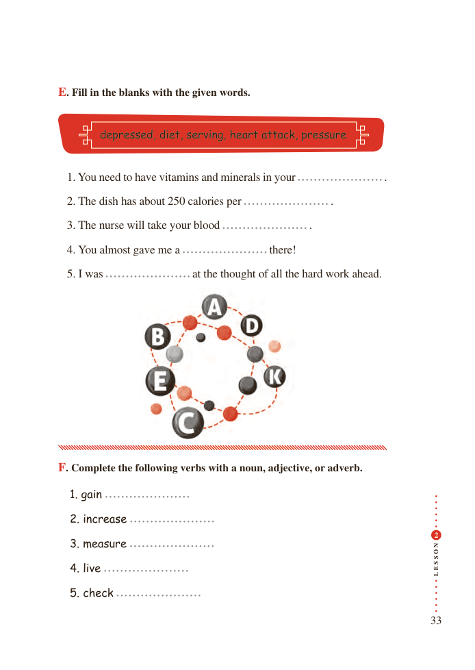

# PDF page 33

E. Fill in the blanks with the given words.

       depressed, diet, serving, heart attack, pressure

  1. You need to have vitamins and minerals in your                              .

  2. The dish has about 250 calories per                              .

  3. The nurse will take your blood                              .

  4. You almost gave me a                    there!

  5. I was                     at the thought of all the hard work ahead.

F. Complete the following verbs with a noun, adjective, or adverb.

   1. gain

  2. increase
                                                                                                  2

                                             N  3. measure
                                             O

                                             S

                                             S
                                             E  4. live                                        L
  5. check

                                                                  33

