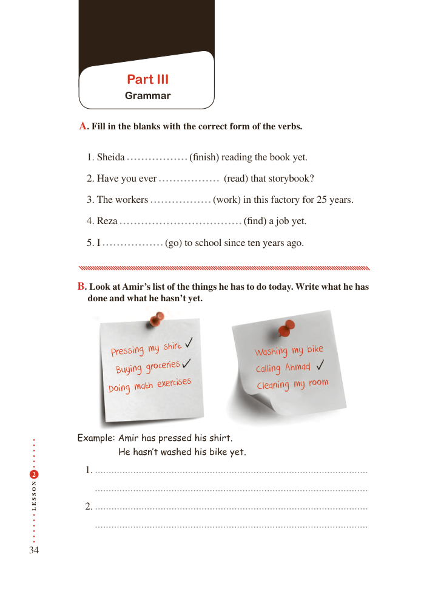

# PDF page 34

Part III
               Grammar

          A. Fill in the blanks with the correct form of the verbs.

               1. Sheida                 (finish) reading the book yet.

               2. Have you ever                (read) that storybook?

               3. The workers              (work) in this factory for 25 years.

               4. Reza                                 (find) a job yet.

               5. I               (go) to school since ten years ago.

          B. Look at Amir’s list of the things he has to do today. Write what he has
            done and what he hasn’t yet.

                                                                   bike                   Pressing my shirt               Washing my
                              groceries                    Calling Ahmad                   Buying
                                exercises               Cleaning my room                  Doing math

          Example: Amir has pressed his shirt.
               He hasn’t washed his bike yet.
 2             1.

N
O

S

S
E
L            2.

34

