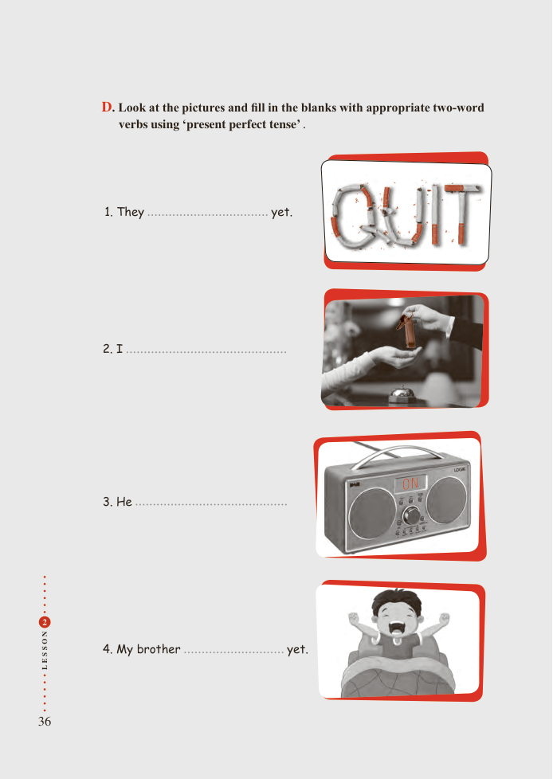

# PDF page 36

D. Look at the pictures and fill in the blanks with appropriate two-word
              verbs using ‘present perfect tense’ .

                1. They                        yet.

             2. I

             3. He

 2

N
O

SS          4. My brother                    yet.
E
L

36

