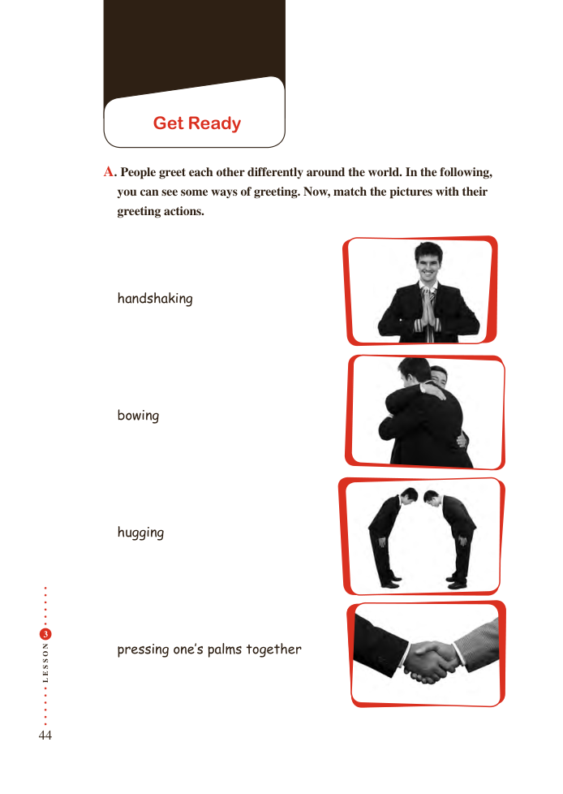

# PDF page 44

Get Ready

         A. People greet each other differently around the world. In the following,
            you can see some ways of greeting. Now, match the pictures with their
              greeting actions.

           handshaking

           bowing

            hugging

 3

NO          pressing one’s palms together
S

S
E
L

44

