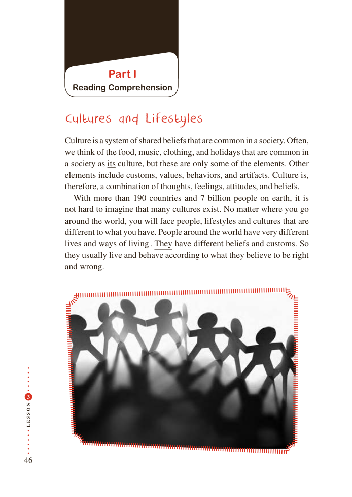

# PDF page 46

Part I
          Reading Comprehension

       Cultures and Lifestyles

           Culture is a system of shared beliefs that are common in a society. Often,
        we think of the food, music, clothing, and holidays that are common in
          a society as its culture, but these are only some of the elements. Other
          elements include customs, values, behaviors, and artifacts. Culture is,
            therefore, a combination of thoughts, feelings, attitudes, and beliefs.
            With more than 190 countries and 7 billion people on earth, it is
           not hard to imagine that many cultures exist. No matter where you go
          around the world, you will face people, lifestyles and cultures that are
            different to what you have. People around the world have very different
            lives and ways of living . They have different beliefs and customs. So
           they usually live and behave according to what they believe to be right
          and wrong.

 3

N
O

S

S
E
L

46

