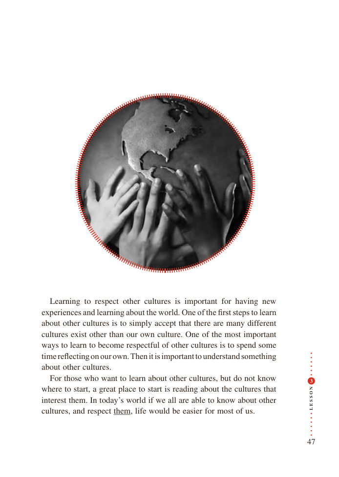

# PDF page 47

Learning to respect other cultures is important for having new
experiences and learning about the world. One of the first steps to learn
about other cultures is to simply accept that there are many different
cultures exist other than our own culture. One of the most important
ways to learn to become respectful of other cultures is to spend some
time reflecting on our own. Then it is important to understand something
about other cultures.
  For those who want to learn about other cultures, but do not know            3

                                             Nwhere to start, a great place to start is reading about the cultures that     O

                                             S

                                             Sinterest them. In today’s world if we all are able to know about other     E
cultures, and respect them, life would be easier for most of us.         L

                                                                  47

