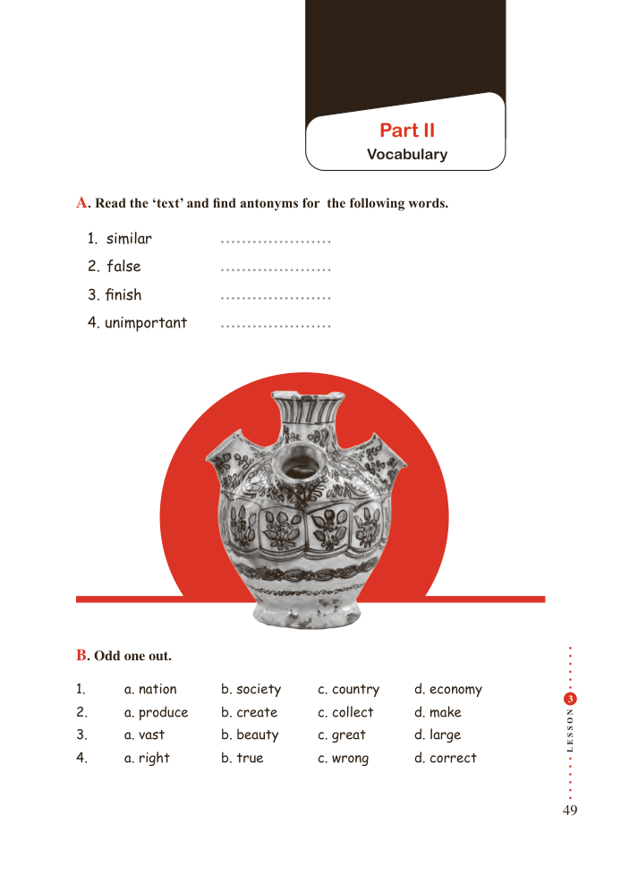

# PDF page 49

Part II
                                    Vocabulary

A. Read the ‘text’ and find antonyms for the following words.

  1. similar
  2. false
  3. finish
  4. unimportant

B. Odd one out.

1.        a. nation        b. society       c. country      d. economy
                                                                                                  3

                                             N2.       a. produce      b. create        c. collect       d. make          O

                                             S

                                             S3.       a. vast          b. beauty        c. great         d. large          E
4.       a. right         b. true           c. wrong        d. correct        L

                                                                  49

