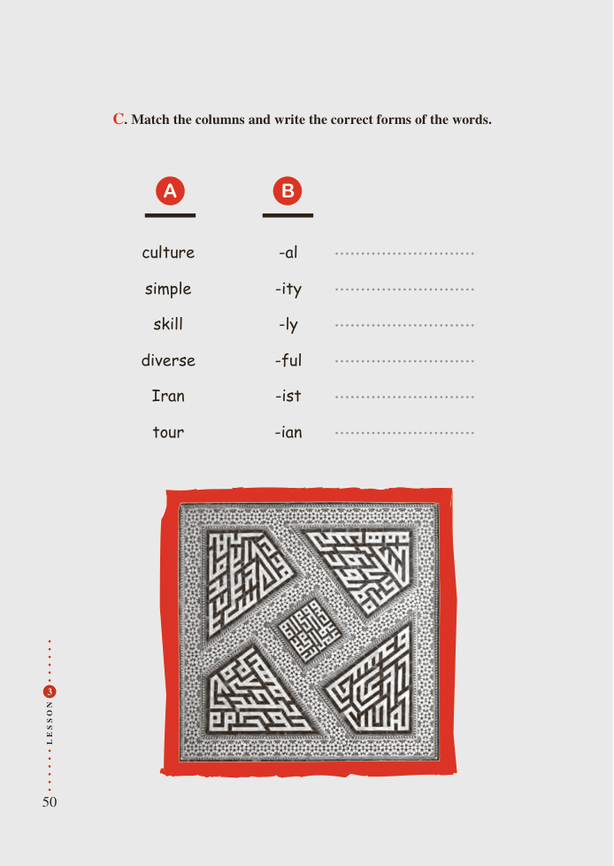

# PDF page 50

C. Match the columns and write the correct forms of the words.

         A        B

             culture             -al

             simple            -ity

                   skill               -ly

             diverse            -ful

             Iran              -ist

              tour             -ian

 3

N
O

S

S
E
L

50

