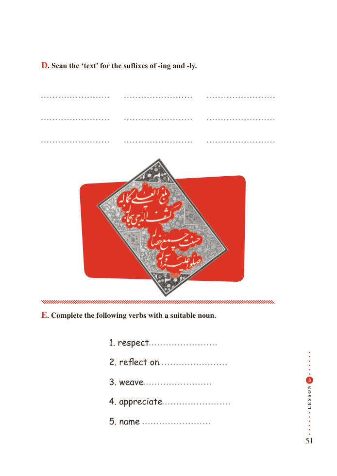

# PDF page 51

D. Scan the ‘text’ for the suffixes of -ing and -ly.

E. Complete the following verbs with a suitable noun.

                      1. respect

                  2. reflect on

                  3. weave                            N3
                                             O

                                             S

                                             S
                                             E                  4. appreciate                         L
                  5. name

                                                                  51

