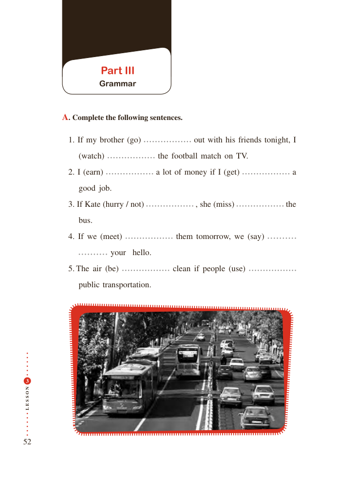

# PDF page 52

Part III
              Grammar

         A. Complete the following sentences.

              1. If my brother (go)               out with his friends tonight, I
               (watch)                the football match on TV.
              2. I (earn)              a lot of money if I (get)              a
             good job.
              3. If Kate (hurry / not)                         , she (miss)               the
                bus.
              4. If we (meet)             them tomorrow, we (say)
                       your  hello.
              5. The air (be)               clean if people (use)
                public transportation.

 3

N
O

S

S
E
L

52

