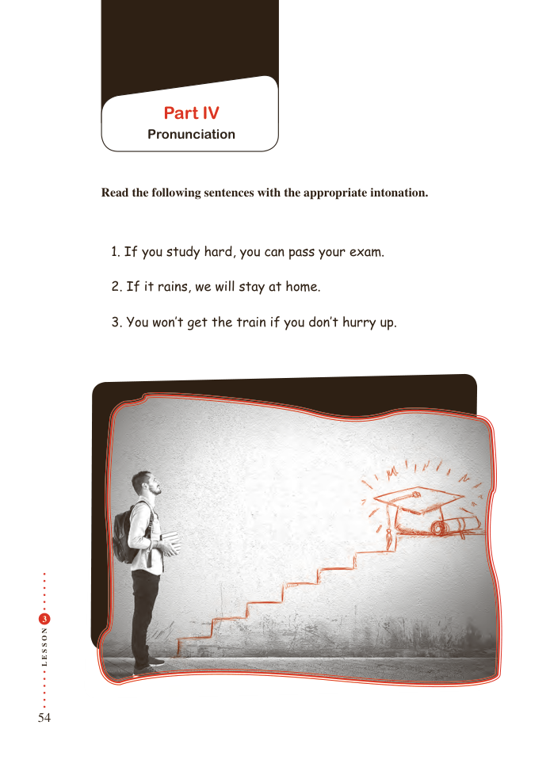

# PDF page 54

Part IV
                Pronunciation

         Read the following sentences with the appropriate intonation.

                1. If you study hard, you can pass your exam.

             2. If it rains, we will stay at home.

             3. You won’t get the train if you don’t hurry up.

 3

N
O

S

S
E
L

54

