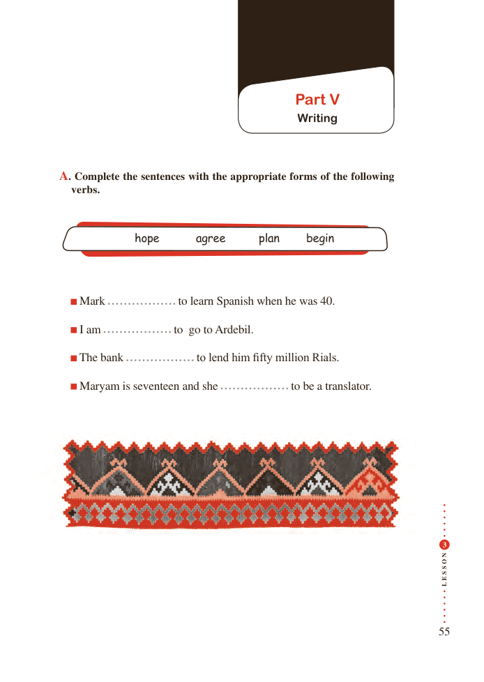

# PDF page 55

Part V
                                          Writing

A. Complete the sentences with the appropriate forms of the following
  verbs.

            hope      agree      plan     begin

   Mark                to learn Spanish when he was 40.

     I am                to go to Ardebil.

   The bank                to lend him fifty million Rials.

   Maryam is seventeen and she                to be a translator.

                                                                                                  3

                                             N
                                             O

                                             S

                                             S
                                             E
                                             L

                                                                  55

