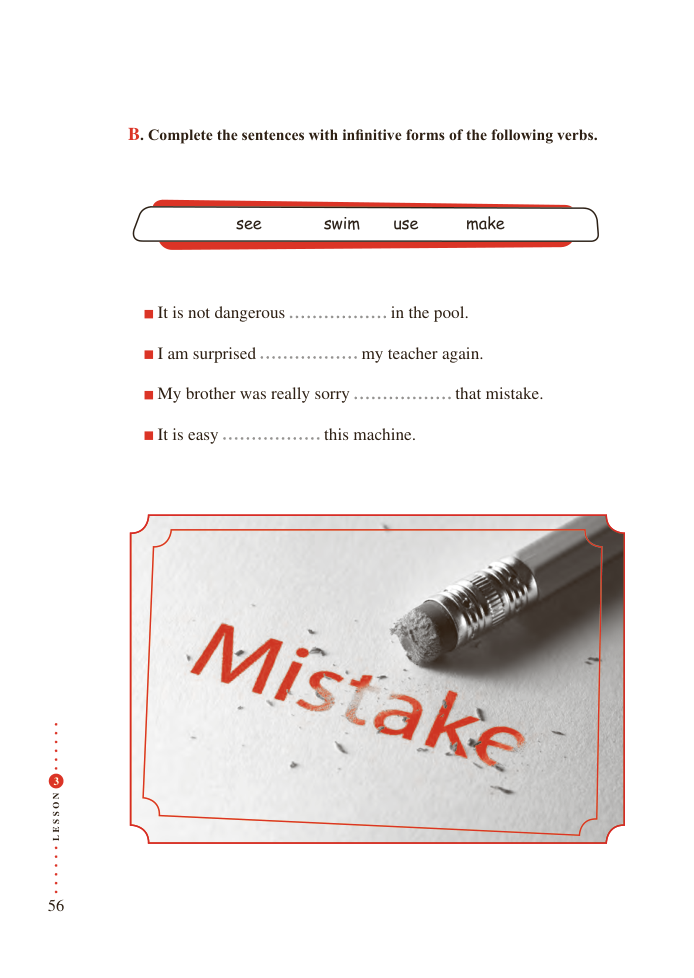

# PDF page 56

B. Complete the sentences with infinitive forms of the following verbs.

                      see       swim    use     make

                     It is not dangerous                in the pool.

                   I am surprised          my teacher again.

         My brother was really sorry                that mistake.

                     It is easy                 this machine.

 3

N
O

S

S
E
L

56

