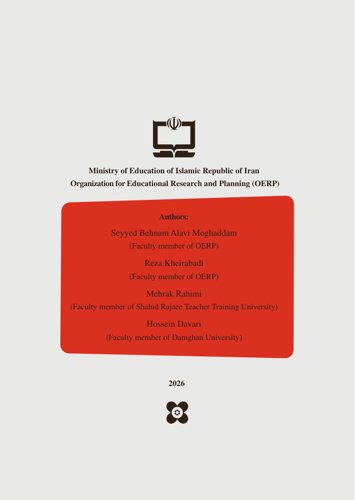

# PDF page 60

Ministry of Education of Islamic Republic of Iran
             Organization for Educational Research and Planning (OERP)

                                     Authors:
                    Seyyed Behnam Alavi Moghaddam
                               (Faculty member of OERP)

                           Reza Kheirabadi
                               (Faculty member of OERP)

                           Mehrak Rahimi
              (Faculty member of Shahid Rajaee Teacher Training University)

                              Hossein Davari
                        (Faculty member of Damghan University)

                                    2026

 3

N
O

S

S
E
L

60

