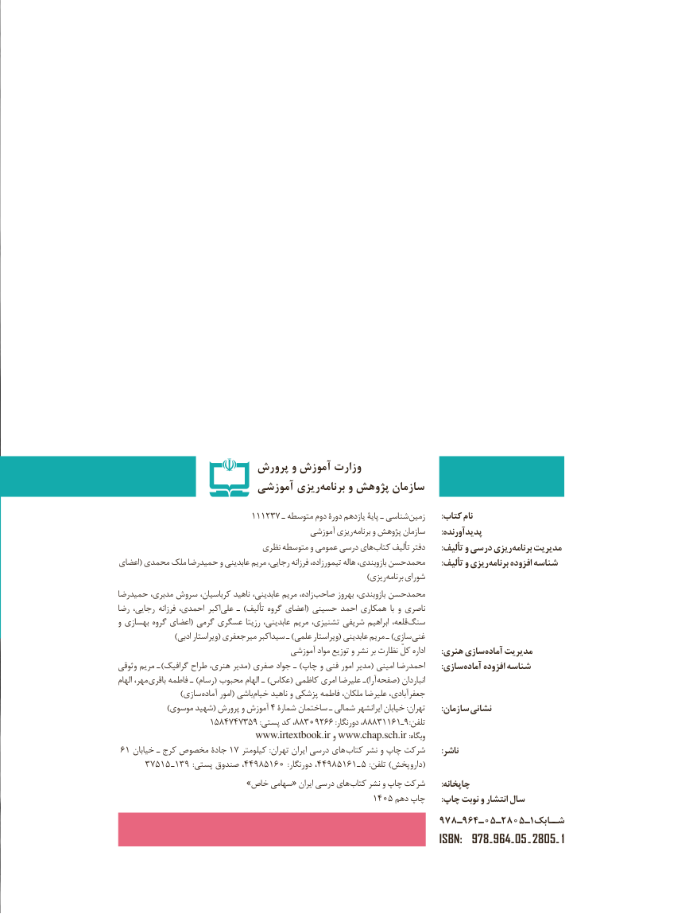

# PDF page 2

پرورش و آموزش وزارت
                       آموزشي ريزي‌برنامه و پژوهش سازمان

                            111237 ـ متوسطه دوم دورۀ یازدهم پایۀ ـ شناسی زمین       :کتاب نام
                                              آموزشی ریزی برنامه و پژوهش سازمان       :پدیدآورنده
                                نظری متوسطه و عمومی درسی های کتاب تألیف دفتر : تألیف و درسی ریزی برنامه مدیریت
اعضای( محمدی ملک حمیدرضا و عابدینی مریم رجایی، فرزانه تیمورزاده، هاله بازوبندی، محمدحسن       :تألیف و ریزی برنامه افزوده شناسه
                                                                                   )ریزی برنامه شورای
حمیدرضا مدبری، سروش کرباسیان، ناهید عابدینی، مریم زاده، صاحب بهروز بازوبندی، محمدحسن
رضا رجایی، فرزانه احمدی، اکبر علی ـ )تألیف گروه اعضای( حسینی احمد همکاری  با و ناصری
و بهسازی گروه اعضای( گرمی عسگری رزیتا عابدینی، مریم تشنیزی، شریفی ابراهیم قلعه، سنگ
  ) ادبی ویراستار( جعفری میر اکبر سید ـ )علمی ویراستار( عابدینی مریم ـ )سازی غنی
                                         آموزشی مواد توزیع و نشر بر نظارت کلّ اداره       :هنری سازیآماده‌    مدیریت
وثوقی مریم ـ )گرافیک طراح هنری، مدیر( صفری جواد ـ )چاپ و فنی امور مدیر( امینی احمدرضا : سازی آماده افزوده شناسه
الهام مهر، باقری فاطمه ـ )رسام( محبوب الهام ـ )عکاس( کاظمی امری علیرضا ـ)آرا صفحه( انباردان
     ) سازی آماده امور( باشی خیام ناهید و پزشکی فاطمه ملکان، علیرضا جعفرآبادی،
                )موسوی شهید( پرورش و آموزش ٤ شمارۀ ساختمان ـ شمالی ایرانشهر خیابان :تهران       :سازمان نشانی
           ١٤٨٥٧٤٧٣٨٨،٩٥٣٩٠٢٨٨٨،:پستی کد    ٦٦٣١١٦١٩ـ:دورنگار                                       :تلفن
                               www.irtextbook.ir و www.chap.sch.ir :وبگاه
 ٦١ خیابان١٧ـ کرج مخصوص جادۀ    کیلومتر :تهران ایران درسی های کتاب نشر و چاپ شرکت       :ناشر
     ٣٧٥١٥ ـ١٣٩ :پستی صندوق ،58944 106 :دورنگار١٦١٥٨٩٤٤،       ـ (٥ :تلفن )داروپخش
  » خاص سهامی« ایران درسی های کتاب نشر و چاپ شرکت       :چاپخانه
                  :1504دهم چاپ   چاپ نوبت و انتشار سال
                                                      978ـ964ـ05ـ2805ـ1شــابك
                                                                      ISBN:  978 ـ  964 ـ  05 ـ  2805 ـ   1

