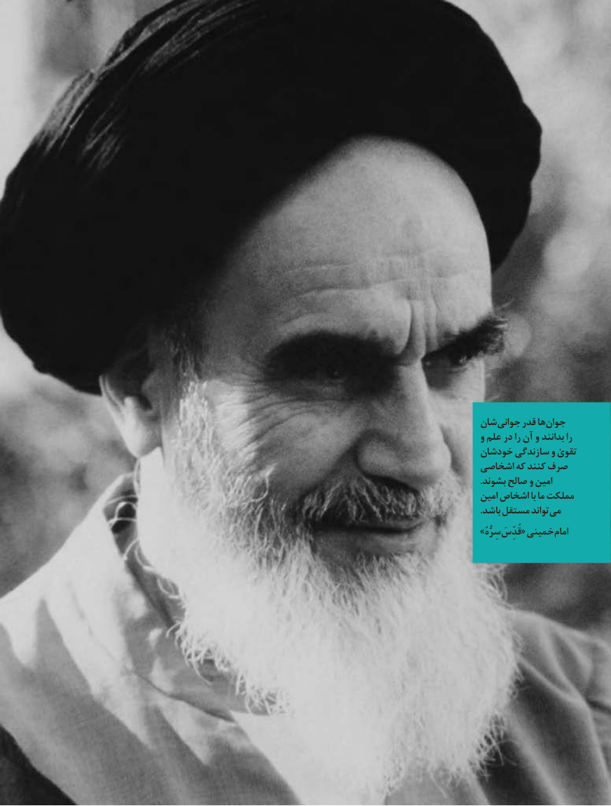

# PDF page 3

شان جوانی قدر هاجوان‌
و علم در را آن و بدانند را
خودشان سازندگی و تقویٰ
اشخاصی كه كنند صرف
.بشوند صالح و امین
امین اشخاص با ما مملكت
.‌باشد مستقل تواندمی
» سِرُّهُ قُدِّسَخمینی«            امام

