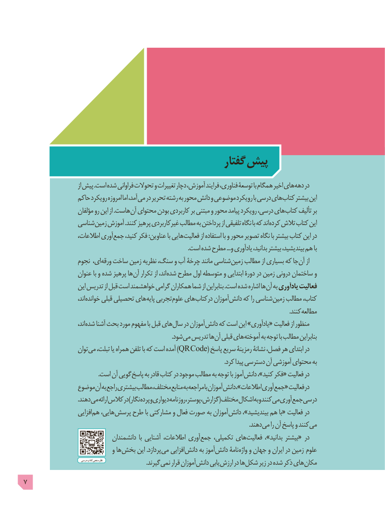

# PDF page 7

گفتار  پیش
                              از پیش .است شده فراوانی تحوالت و تغییرات دچار ،آموزش فرایند ،فناوری توسعۀ با همگام اخیر های دهه در
                 حاکم رویکرد امروزه اما ،آمد می در تحریر رشته به محور دانش و موضوعی رویکرد با درسی های کتاب بیشتر این
                     مؤلفان رو این از .هاست آن محتوای بودن کاربردی بر مبتنی و محور پیامد رویکرد ،درسی های کتاب تألیف بر
                شناسی زمین آموزش .کنند پرهیز کاربردی غیر مطالب به پرداختن از تلفیقی نگاه با که اند کرده تالش کتاب این
                   ،اطالعات آوری جمع ،کنید فکر :عناوین با هایی فعالیت از استفاده با و محور تصویر نگاه با بیشتر کتاب این در
                                                                                                             .است شده مطرح ...و یادآوری ،بدانید بیشتر ،بیندیشید هم با
                 نجوم ،ای ورقه ساخت زمین نظریه ،سنگ و آب چرخۀ مانند شناسی زمین مطالب از بسیاری که جا آن از
                   عنوان با و شده پرهیز ها آن تکرار از ،اند شده مطرح اول متوسطه و ابتدایی دورة در زمین درونی ساختمان و
                    این تدریس از قبل است خواهشمند گرامی همکاران شما از بنابراین .است شده اشاره ها آن به یادآوری فعالیت
                             ،اند خوانده قبلی تحصیلی های پایه تجربی علوم های درکتاب آموزان دانش که را شناسی زمین مطالب ،کتاب
                                                                                                                                                                                 .کنندمطالعه
                             ،اند شده آشنا بحث مورد مفهوم با قبل های سال در آموزان دانش که است این »«یادآوری  فعالیت از منظور
                       . شود می تدریس ها آن قبلی های آموخته به توجه با مطالب بنابراین
                     توان می ،تبلت یا همراه تلفن با که است آمده )QR Code( پاسخ سریع رمزینۀ نشانۀ ،فصل هر ابتدای در
                                                                                                                                     .کرد پیدا دسترسی آن آموزشی محتوای به
                                                  .است آن گویی پاسخ به قادر کتاب در موجود مطالب به توجه با آموز دانش ،»کنید فکر« فعالیت در
                موضوع آن به راجع بیشتری مطالب ،مختلف منابع به مراجعه با آموزان دانش ،»اطالعات آوری «جمع فعالیت در
       . دهند می ارائه کالس در )نگار پرده و دیواری روزنامه ،پوستر ،گزارش( مختلف اشکال به و کنند می آوری جمع درسی
                       افزایی هم ،هایی پرسش طرح با مشارکتی و فعال صورت به آموزان دانش ،»بیندیشید هم با« فعالیت در
                               . دهند می را آن پاسخ و کنند می
                                 دانشمندان  با آشنایی ،اطالعات آوری جمع ،تکمیلی های فعالیت  ،»بدانید بیشتر« در
                                و ها بخش این .پردازد می افزایی دانش به آموز دانش نامۀ واژه و جهان و ایران در زمین  علوم
                                     درسی کتاب نظرسنجی               . گیرند نمی قرار آموزان دانش یابی ارزش در ها شکل زیر در شده ذکر های مکان
7

