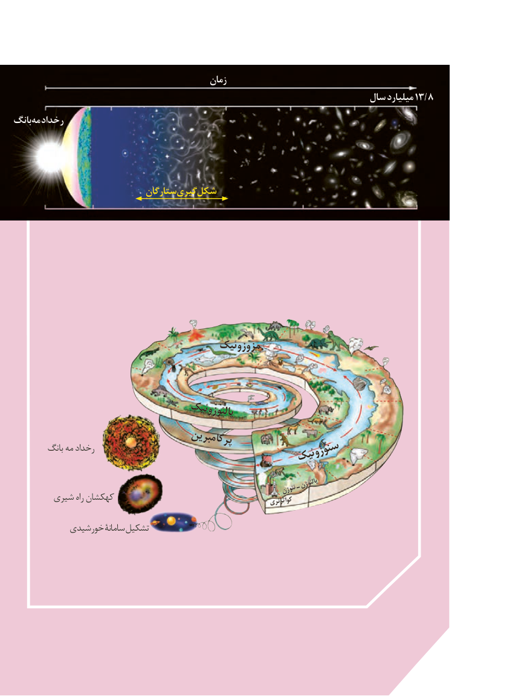

# PDF page 8

زمان
                                                                  سال میلیارد 13/8
بانگ مه رخداد

                              ستارگانگیری شکل

                                        مزوزوئیک

                                      پالئوزوئیک
                                    پرکامبرین         بانگ مه رخداد                                                سنوزوئیک
                                             ـپالئوژن                                                                                نئوژن
        شیری راه کهکشان                                                    کواترنری

           خورشیدی سامانۀ تشکیل

