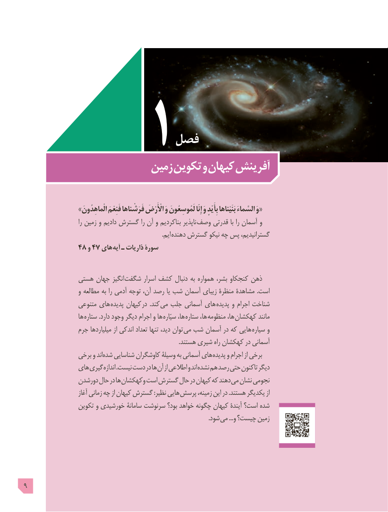

# PDF page 9

فصل
                       زمين تكوين و کیهان آفرینش

                »الْماهِدُونَ فَنِعْمَ فَرَشْناها اأْْلَْأَْرْضَ وَ لَمُوسِعُونَ إِنّا وَ بِأَیْدٍ بَنَیْناها السَّماءَ وَ«
                             را زمین و دادیم گسترش را آن و بناکردیم ناپذیر وصف قدرتی با را آسمان و
                         . ایم دهنده گسترش نیکو چه پس ،گسترانیدیم
             ٤٨٤٧و   های آیه ـ ذاریات سورۀ

              هستی جهان انگیز شگفت اسرار کشف دنبال به همواره ،بشر کنجکاو ذهن
                   و مطالعه به را آدمی توجه ،آن رصد یا شب آسمان زیبای منظرۀ مشاهدۀ .است
                  متنوعی های پدیده کیهان  در  .کند می جلب آسمانی های پدیده و اجرام شناخت
                    ها ستاره .دارد وجود دیگر اجرام  و ها سیّاره ،ها ستاره ،ها منظومه ،ها کهکشان مانند
                جرم میلیاردها از اندکی تعداد تنها ،دید توان می شب آسمان در كه هایی سیاره و
                                                                                                      .هستند شیری راه كهكشان در آسمانی
                برخی و اندشده‌   شناسایی کاوشگران وسیلۀ به آسمانی های پدیده و اجرام از برخی
               های گیری اندازه .نیست دست در ها آن از اطالعی و اند نشده هم رصد حتی تاکنون ديگر
                دورشدن حال در ها وکهکشان است گسترش حال در کیهان كه دهند می نشان نجومی
                        آغاز زمانی چه از کیهان گسترش :نظیر هايی پرسش ،زمینه اين در .هستند یکدیگر از
                 تکوین و خورشیدی سامانۀ سرنوشت بود؟ خواهد چگونه کیهان آیندۀ است؟ شده
                            . شود می ...و چیست؟ زمین

9

