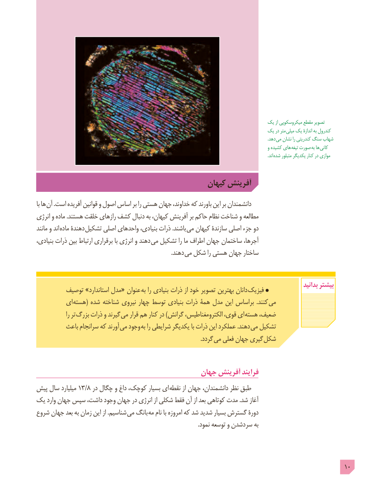

# PDF page 10

یک از میکروسکوپی مقطع تصویر
                                                                     یک در متر میلی یک اندازۀ به کندرول
                                                                                                                                                                                                                       .دهد می نشان را کندریتی سنگ شهاب
                                                                                                                     و کشیده های تیغه صورت به ها کانی
                                                                                                                                                                                                                       .اند  شده متبلور یکدیگر کنار در موازی

                                               کیهان آفرینش
با ها آن .است آفریده قوانین و اصول اساس بر را هستی جهان ،خداوند که باورند این بر دانشمندان
انرژی و ماده .هستند خلقت رازهای کشف دنبال به ،کیهان آفرینش بر حاکم نظام شناخت و مطالعه
مانند و اند ماده دهندۀ تشکیل اصلی واحدهای ،بنیادی ذرات .باشند می کیهان سازندۀ اصلی جزء دو
،بنیادی ذرات بین ارتباط برقراری با انرژی و دهند می تشکیل را ما اطراف جهان ساختمان ،آجرها
                  . دهند می شکل را هستی جهان ساختار

                                                                                                              بدانید بیشتر        توصیف »استاندارد مدل« عنوان  به را بنیادی ذرات از خود تصویر بهترین دانان فیزیک
         ای (هسته شده شناخته نیروی چهار توسط بنیادی ذرات همۀ مدل این براساس  .کنند می
                را تر  بزرگ ذرات و گیرند  می قرار هم کنار در )گرانش ،الکترومغناطیس ،قوی ای هسته ،ضعیف
          باعث سرانجام که آورند  می وجود به را شرایطی یکدیگر با ذرات این عملکرد .دهند می تشکیل
                                                                                                                 .گردد می فعلی جهان گیری شکل

                                         جهان آفرینش فرایند
پیش سال میلیارد 13/8 در چگال و داغ ،کوچک بسیار ای نقطه از جهان ،دانشمندان نظر طبق
یک وارد جهان سپس ،داشت وجود جهان در انرژی از شکلی فقط آن از بعد کوتاهی مدت .شد آغاز
شروع جهان بعد به زمان این از .شناسیم می بانگ  مه نام با امروزه که شد شدید بسیار گسترش دورۀ
                                                                                                               .نمود توسعه و سردشدن به

                                                                                             10

