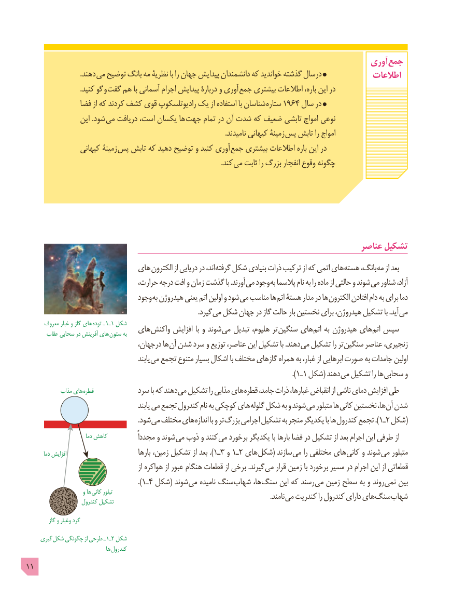

# PDF page 11

آوری جمع
                               .دهند می توضيح بانگ مه نظريۀ با را جهان پيدايش دانشمندان كه خوانديد گذشته درسال             اطالعات
                               .کنید گو و گفت هم با آسمانی اجرام پیدایش دربارۀ و آوری جمع بیشتری اطالعات ،باره این در
               فضا از که کردند کشف قوی رادیوتلسکوپ یک از استفاده با شناسان  ستاره 1964 سال در
                 این .شود می دریافت ،است یکسان ها  جهت تمام در آن شدت که ضعیف تابشی امواج نوعی
                                                                                                                 .نامیدند کیهانی زمینۀ پس تابش را امواج
                کیهانی زمینۀ  پس تابش که دهید توضیح و کنید آوری جمع بیشتری اطالعات باره این در
                           . کند می ثابت را بزرگ انفجار وقوع چگونه

                                                                              عناصر تشکیل
                           های الکترون از دریایی در ،اند گرفته شکل بنیادی ذرات ترکیب از که اتمی های هسته ،بانگ مه از بعد
                                 ،حرارت درجه افت و زمان گذشت با .آورند می وجود به پالسما نام به را ماده از حالتی و شوند می شناور ،آزاد
                                وجود به هیدروژن یعنی اتم اولین و شود می مناسب ها اتم هستۀ مدار در ها الکترون افتادن دام به برای دما
                     . گیرد می شکل جهان در گاز حالت بار نخستین برای ،هیدروژن تشکیل با .آید می
      معروف غبار و گاز های توده ـ 1ـ1 شکل                           های واکنش افزایش با و شوند می تبدیل ،هلیوم تر سنگین های اتم به هیدروژن های اتم سپس       عقاب سحابی در آفرینش های ستون به
                                  ،درجهان ها آن شدن سرد و توزیع ،عناصر این تشکیل با .دهند می تشکیل را تر سنگین عناصر ،زنجیری
                                              یابند می تجمع متنوع بسیار اشکال با مختلف گازهای همراه به ،غبار از ابرهایی صورت به جامدات اولین
                                                                                                    .)1ـ1 شکل( دهند می تشکیل را ها سحابی و
            مذاب های قطره            سرد با که دهند می تشکیل را مذابی های قطره ،جامد ذرات ،غبارها انقباض از ناشی دمای افزایش طی
                                              یابند می تجمع کندرول نام به کوچکی های گلوله شکل به و شوند می متبلور ها کانی نخستین ،ها آن شدن
                                                                 .شود می مختلف های اندازه با و تر بزرگ اجرامی تشکیل به منجر یکدیگر با ها کندرول تجمع .)١ـ2 شکل(
                            دما کاهش           ًمجددا و شوند می ذوب و کنند می برخورد یکدیگر با بارها فضا در تشکیل از بعد اجرام این طرفی از
        دما افزایش                            بارها ،زمین تشکیل از بعد .)١ـ3 و ١ـ2 های (شکل سازند می را مختلفی های کانی و شوند می متبلور
                                                     از هواکره از عبور هنگام قطعات از برخی .گیرند می قرار زمین با برخورد مسیر در اجرام این از قطعاتی
                                                         .)١ـ٤ شکل( شوند می نامیده سنگ شهاب ،ها سنگ این که رسند می زمین سطح به و روند نمی بین
                        و ها کانی تبلور                   . نامند می کندریت را کندرول دارای های سنگ شهاب                     کندرول تشکیل
           گاز و وغبار گرد
     گیری شکل چگونگی از طرحی ـ١ـ2 شکل
                                   ها کندرول
11

