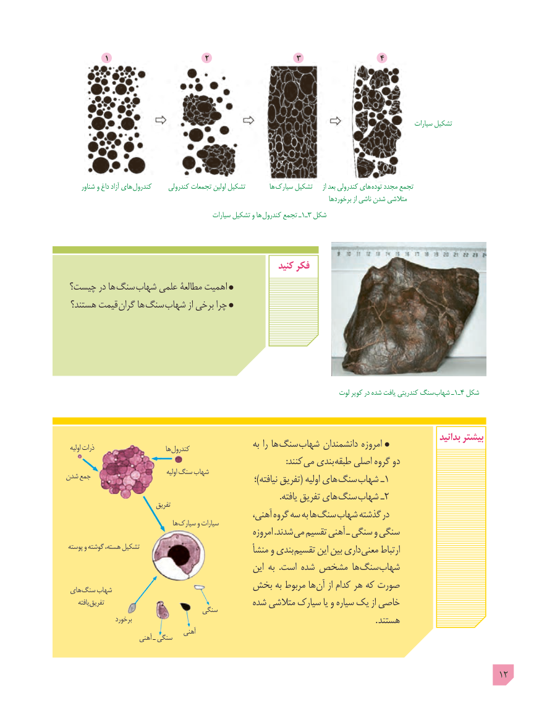

# PDF page 12

1                      2                    3                  4

                                                                                                                    سیارات تشکیل

      شناور و داغ آزاد های کندرول     کندرولی تجمعات اولین تشکیل         ها سیارک تشکیل     از بعد کندرولی های  توده مجدد تجمع
                                                                                             برخوردها از ناشی شدن متالشی
                                                 سیارات تشکیل و ها کندرول تجمع ـ١ـ3 شکل

                                                      کنید فکر
 چیست؟ در ها سنگ شهاب علمی مطالعۀ اهمیت
 هستند؟ قیمت گران ها  سنگ شهاب از برخی چرا

                                                                               لوت کویر در شده یافت کندریتی سنگ  شهاب ـ١ـ4 شکل

                                                                                                          بدانید بیشتر                                                       به را ها سنگ شهاب دانشمندان امروزه  اولیه ذرات                          ها کندرول
                                                                                                         :کنند می بندی طبقه اصلی گروه دو
                                              اولیه سنگ شهابشدن جمع                                                                     ؛)نیافته تفریق( اولیه های سنگ شهاب ـ1
                                                                                                      .یافته تفریق های سنگ شهاب ـ2                              تفریق
                                                ،آهنی گروه سه به ها سنگ شهاب گذشته در                                       ها سیارک و سیارات
                                                       امروزه .شدند می تقسیم آهنی ـ سنگی و سنگی
 پوسته و گوشته ،هسته تشکیل                            منشأ و بندی تقسیم این بین داری معنی ارتباط
                                                  این به  .است شده مشخص ها سنگ شهاب
                            بخش به مربوط ها آن از کدام هر که صورت های سنگ شهاب
     یافته تفریق                                شده متالشی سیارک یا و سیاره یک از خاصی                                   سنگی
                  برخورد                                                                                                        . هستند
                                     آهنی                       آهنی ـ سنگی

                                                                                          12

