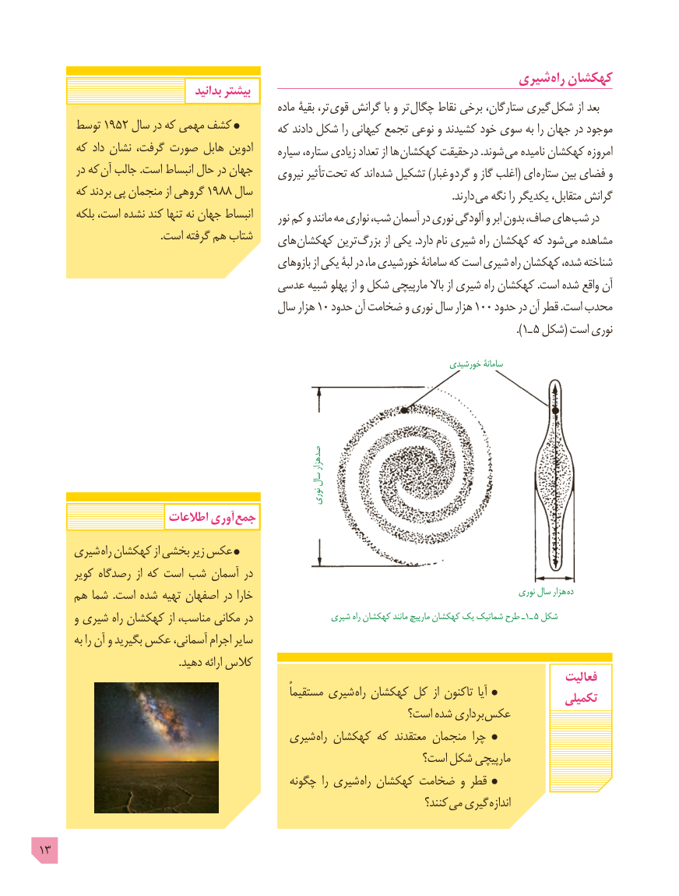

# PDF page 13

شیری راه کهکشان
                                   بدانید بیشتر
                                                        ماده بقیۀ ،تر قوی گرانش با و تر چگال نقاط برخی ،ستارگان گیری  شکل از بعد
      توسط 1952 سال در که مهمی کشف                                          که دادند شکل را کیهانی تجمع نوعی و کشیدند خود سوی به را جهان در موجود
      که داد نشان ،گرفت صورت هابل ادوین                                                     سیاره ،ستاره زیادی تعداد از ها کهکشان درحقیقت .شوند  می نامیده کهکشان امروزه
        در که آن جالب .است انبساط حال در جهان                                              نیروی تأثیر تحت که اند شده تشکیل )غبار و  گرد و گاز اغلب( ای  ستاره بین فضای و
      که بردند پی منجمان از گروهی 1988 سال                                . دارند می نگه را یکدیگر ،متقابل گرانش
        بلکه ،است نشده کند تنها نه جهان انبساط                                                            نور کم و مانند مه نواری ،شب آسمان در نوری آلودگی و ابر بدون ،صاف های شب در
                                              .است گرفته هم شتاب                                      های کهکشان ترین بزرگ از یکی .دارد نام شیری راه کهکشان که شود می مشاهده
                                                  بازوهای از یکی لبۀ در ،ما خورشیدی سامانۀ که است شیری راه کهکشان ،شده شناخته
                                   عدسی شبیه پهلو از و شکل مارپیچی باال از شیری راه کهکشان .است شده واقع آن
                                        سال هزار 10 حدود آن ضخامت و نوری سال هزار 100 حدود در آن قطر .است محدب
                                                                                                                       ).1ـ 5 شکل( است نوری

                                                                                          خورشیدی سامانۀ

                                                                                  صدهزار
                                         سال
                                                       نوری
                       اطالعات آوری  جمع
     شیری راه کهکشان از بخشی زیر عکس
       کویر رصدگاه از که است شب آسمان در
     هم شما  .است شده تهیه اصفهان در خارا                                                                نوری سال هزار ده
       و شیری راه کهکشان از ،مناسب مکانی در                شیری راه کهکشان مانند مارپیچ کهکشان یک شماتیک طرح ـ١ـ 5 شکل
        به را آن و بگیرید عکس ،آسمانی اجرام سایر
                                                     .دهید ارائه کالس
                                                                                                   فعالیت
                                                           ًمستقیما شیری راه کهکشان کل از تاکنون  آیا                                                                                              تکمیلی
                                                            است؟ شده برداری عکس
                                      شیری راه کهکشان که معتقدند منجمان چرا
                                                              است؟ شکل مارپیچی
                                              چگونه  را شیری راه کهکشان ضخامت و قطر
                                                                                  کنند؟ می گیری اندازه

13

