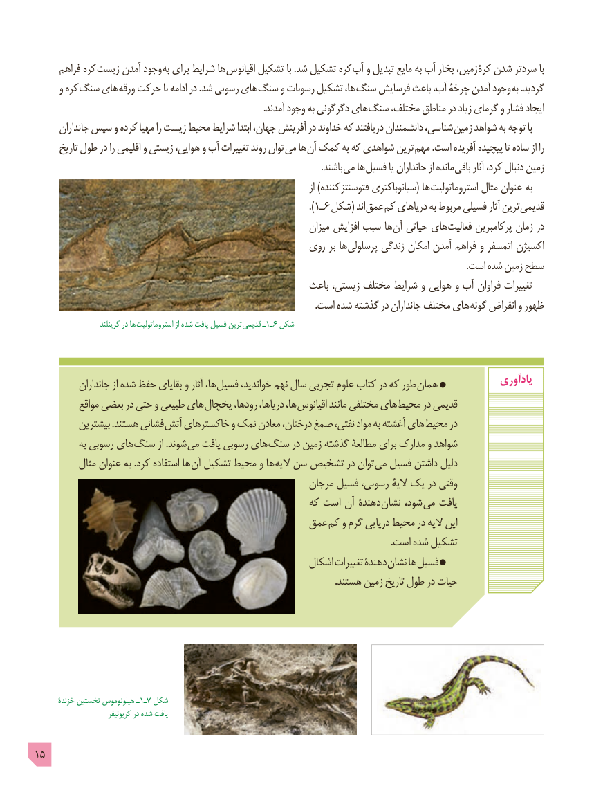

# PDF page 15

فراهم کره زیست آمدن وجود به برای شرایط ها اقیانوس تشکیل با .شد تشکیل کره آب و تبدیل مایع به آب بخار ،زمین کرۀ شدن سردتر با
      و کره سنگ های ورقه حرکت با ادامه در .شد رسوبی های سنگ و رسوبات تشکیل ،ها سنگ فرسایش باعث ،آب چرخۀ آمدن وجود به .گردید
                                                                                                    .آمدند وجود به دگرگونی های سنگ ،مختلف مناطق در زیاد گرمای و فشار ایجاد
      جانداران سپس و کرده مهیا را زیست محیط شرایط ابتدا ،جهان آفرینش در خداوند که دریافتند دانشمندان ،شناسی زمین شواهد به توجه با
      تاریخ طول در را اقلیمی و زیستی ،هوایی و آب تغییرات روند توان می ها آن کمک به که شواهدی ترین مهم .است آفریده پیچیده تا ساده از را
                                                                                                                              .باشند می ها فسیل یا جانداران از مانده باقی آثار ،کرد دنبال زمین
                                                                                                   از )کننده فتوسنتز سیانوباکتری( ها استروماتولیت مثال عنوان به
                                                                           .)1ـ ٦ (شکل  اند عمق کم دریاهای به مربوط فسیلی آثار ترین قدیمی
                                                                   میزان افزایش سبب ها آن حیاتی های فعالیت پرکامبرین زمان در
                                                  روی بر ها پرسلولی زندگی امکان آمدن فراهم و اتمسفر اکسیژن
                                                                                                                                                                                             .است شده زمین سطح
                                                        باعث ،زیستی مختلف شرایط و هوایی و آب فراوان تغییرات
                                                                                                                       .است شده گذشته در جانداران مختلف های گونه انقراض و ظهور
                       گرینلند در ها استروماتولیت از شده یافت فسیل ترین قدیمی ـ1ـ ٦ شکل

           جانداران از شده حفظ بقایای و آثار ،ها فسیل ،خواندید نهم سال تجربی علوم کتاب در که طور همان             یادآوری
           مواقع بعضی در حتی و طبیعی های یخچال ،رودها ،دریاها ،ها اقیانوس مانند مختلفی های محیط در قدیمی
          بیشترین .هستند فشانی آتش خاکسترهای و نمک معادن ،درختان صمغ ،نفتی مواد به آغشته های محیط در
            به رسوبی های سنگ از .شوند می یافت رسوبی های سنگ در زمین گذشته مطالعۀ برای مدارک و شواهد
          مثال عنوان به .کرد استفاده ها آن تشکیل محیط و ها الیه سن تشخیص در توان می فسیل داشتن دلیل
                                                       مرجان فسیل ،رسوبی الیۀ یک در وقتی
                                                      که است آن دهندۀ نشان ،شود می یافت
                                            عمق کم و گرم دریایی محیط در الیه این
                                                                                                                                                       .است شده تشکیل
                                                        اشکال تغییرات دهندۀ نشان ها فسیل
                                                                                                                                .هستند زمین تاریخ طول در حیات

       خزندۀ نخستین هیلونوموس ـ1ـ٧ شکل
                          کربونیفر در شده یافت

15

