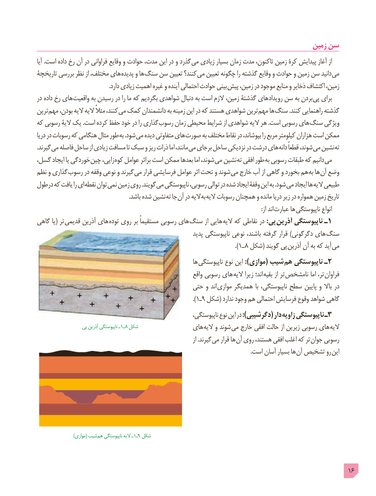

# PDF page 16

زمین سن
آیا .است داده رخ آن در فراوانی وقایع و حوادث ،مدت این در و گذرد می زیادی بسیار زمان مدت ،تاکنون زمین کرۀ پیدایش آغاز از
تاریخچۀ بررسی نظر از ،مختلف های پدیده و ها سنگ سن تعیین کنند؟ می تعیین چگونه را گذشته وقایع و حوادث و زمین سن دانید می
                                                 .دارد زیادی اهمیت غیره و آینده احتمالی حوادث بینی پیش ،زمین در موجود منابع و ذخایر اکتشاف ،زمین
در داده رخ های واقعیت به رسیدن در را ما که بگردیم شواهدی دنبال به است الزم ،زمین گذشتۀ های رویداد سن به بردن پی برای
ترین مهم ،بودن الیه الیه ًمثال ،کنند می کمک دانشمندان به زمینه این در که هستند شواهدی ترین مهم ها سنگ .کنند راهنمایی گذشته
که رسوبی الیۀ یک .است کرده حفظ خود در را گذاری رسوب زمان محیطی شرایط از شواهدی الیه هر .است رسوبی های سنگ ویژگی
دریا در رسوبات که هنگامی مثال طور به .شود می دیده متفاوتی های صورت به مختلف نقاط در ،بپوشاند را مربع کیلومتر هزاران است ممکن
. گیرند می فاصله ساحل از زیادی مسافت تا سبک و ریز ذرات اما ،مانند می برجای ساحل نزدیکی در درشت های دانه ًقطعا ،شوند می نشین ته
،گسل ایجاد یا خوردگی چین ،زایی کوه عوامل براثر است ممکن بعدها اما ،شوند می نشین ته افقی طور به رسوبی طبقات که دانیم می
نظم و گذاری رسوب در وقفه نوعی و گیرند می قرار فرسایشی عوامل اثر تحت و شوند می خارج آب از گاهی و بخورد هم به ها آن وضع
درطول که یافت را ای نقطه توان نمی زمین روی .گویند می ناپیوستگی ،رسوبی توالی در شده ایجاد وقفۀ این به .شود می ایجاد ها الیه طبیعی
                                                               .باشد شده نشین ته جا آن در الیه به الیه رسوبات همچنان و مانده دریا زیر در همواره زمین تاریخ
                                                                                                                                                          :از اند  عبارت ها ناپیوستگی انواع
گاهی یا( تر قدیمی آذرین های توده روی بر ًمستقیما رسوبی های سنگ از هایی الیه که نقاطی در :پی آذرین ناپیوستگی ـ1
                                                             پدید ناپیوستگی نوعی ،باشند گرفته قرار )دگرگونی های سنگ
                                                                                      .)1ـ ٨ شکل( گویند پی آذرین آن به که آید می
                                                            ها ناپیوستگی نوع این :)موازی( شیب  هم ناپیوستگی ـ2
                                                               واقع رسوبی های الیه زیرا اند؛ بقیه از تر نامشخص اما ،تر فراوان
                                            حتی و اند موازی همدیگر با ،ناپیوستگی سطح پایین و باال در
                                                                     ).1ـ٩ شکل( ندارد وجود هم احتمالی فرسایش وقوع شواهد گاهی
                                                             ،ناپیوستگی نوع این در :)دگرشیبی( دار زاویه٣ناپیوستگی ـ
                  پی آذرین ناپیوستگی ـ1ـ ٨ شکل                های الیه و شوند می خارج افقی حالت از زیرین رسوبی های الیه
                                                                                       از .گیرند می قرار ها آن روی ،هستند افقی اغلب که تر جوان رسوبی
                                                                                                                                                     .است آسان بسیار ها آن تشخیص رو این

     )(موازی شیب  هم ناپیوستگی الیه ـ1ـ9 شکل

                                                                                            16

