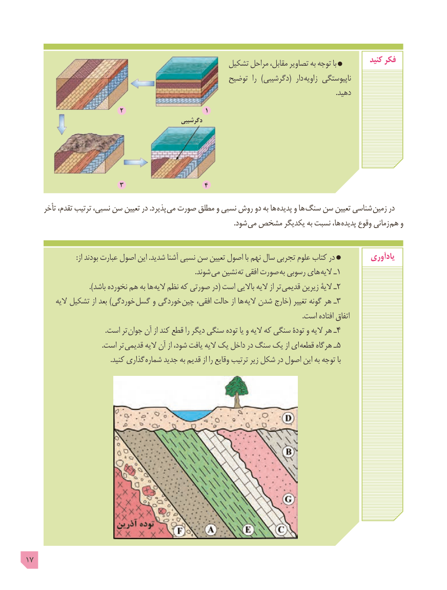

# PDF page 17

تشکیل مراحل ،مقابل تصاویر به توجه با          کنید فکر
                                                     توضیح  را )(دگرشیبی   دار زاویه ناپیوستگی
                                                                                                                                                                                  .دهید
                          2                      1
                                                   دگرشیبی

                          3                      4
      تأخر ،تقدم ترتیب ،نسبی سن تعیین در .پذیرد  می صورت مطلق و نسبی روش دو به ها پدیده و ها سنگ سن تعیین شناسی  زمین در
                                                                                                                       .شود می مشخص یکدیگر به نسبت ،ها پدیده وقوع زمانی هم و

                             :از بودند عبارت اصول این .شدید آشنا نسبی سن تعیین اصول با نهم سال تجربی علوم کتاب در          یادآوری
                                                                                                 .شوند می نشین ته افقی صورت به رسوبی های الیه ـ1
                               .)باشد نخورده هم به ها الیه نظم که صورتی در( است باالیی الیه از تر قدیمی زیرین الیۀ ـ2
          الیه تشکیل از بعد )خوردگی گسل و خوردگی چین ،افقی حالت از ها الیه شدن خارج( تغییر گونه هر ـ3
                                                                                                                                                               .است افتاده اتفاق
                                              .است تر جوان آن از کند قطع را دیگر سنگی توده یا و الیه که سنگی تودۀ و الیه هر ـ4
                                            .است تر قدیمی الیه آن از ،شود یافت الیه یک داخل در سنگ یک از ای قطعه هرگاه ـ5
                                                 .کنید گذاری شماره جدید به قدیم از را وقایع ترتیب زیر شکل در اصول این به توجه با

17

