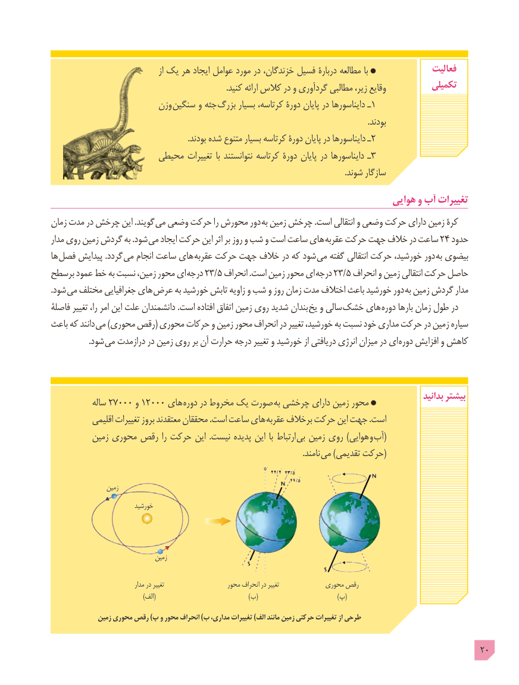

# PDF page 20

از یک هر ایجاد عوامل مورد در ،خزندگان فسیل دربارۀ مطالعه با                فعالیت
                                                                                       .کنید ارائه کالس در و گردآوری مطالبی ،زیر وقایع           تکمیلی
                        وزن  سنگین و جثه بزرگ بسیار ،کرتاسه دورۀ پایان در دایناسورها ـ1
                                                                                                                                                            .بودند
                                                                    .بودند شده متنوع بسیار کرتاسه دورۀ پایان در دایناسورها ـ2
                     محیطی تغییرات  با نتوانستند کرتاسه دورۀ پایان در دایناسورها ـ3
                                                                                                                                                 .شوند سازگار
                                                                         هوایی و آب تغییرات
زمان مدت در چرخش این .گویند می وضعی حرکت را محورش دور به زمین چرخش .است انتقالی و وضعی حرکت دارای زمین کرۀ
مدار روی زمین گردش به .شود می ایجاد حرکت این اثر بر روز و شب و است ساعت های عقربه حرکت جهت خالف در ساعت ٢٤ حدود
ها فصل پیدایش .گردد می انجام ساعت های عقربه حرکت جهت خالف در که شود می گفته انتقالی حرکت ،خورشید دور  به بیضوی
برسطح عمود خط به نسبت ،زمین محور ای درجه 23/5 انحراف .است زمین محور ای درجه 23/5 انحراف و زمین انتقالی حرکت حاصل
.شود می مختلف جغرافیایی های عرض به خورشید تابش زاویه و شب و روز زمان مدت اختالف باعث خورشید دور  به زمین گردش مدار
فاصلۀ تغییر ،را امر این علت دانشمندان .است افتاده اتفاق زمین روی شدید بندان یخ و سالی  خشک های دوره بارها زمان طول در
باعث که دانند می )محوری رقص( محوری حرکات و زمین محور انحراف در تغییر ،خورشید به نسبت خود مداری حرکت در زمین سیاره
    . شود می درازمدت در زمین روی بر آن حرارت درجه تغییر و خورشید از دریافتی انرژی میزان در ای دوره افزایش و کاهش

                                                                                                              بدانید بیشتر            ساله 27000 و 12000 های دوره در مخروط یک صورت به چرخشی دارای زمین محور
            اقلیمی تغییرات بروز معتقدند محققان .است ساعت های عقربه برخالف حرکت این جهت .است
          زمین محوری رقص را حرکت این  .نیست پدیده این با ارتباط بی زمین روی )هوایی و (آب
                                                                                                                            .نامند می )تقدیمی حرکت(

                  زمین
                           خورشید

                                  زمین

                                  مدار در تغییر                    محور انحراف در تغییر            محوری رقص
                                               )الف(                                               )ب(                                        )پ(

              زمین محوری رقص )پ و محور انحراف )ب مداری، تغییرات )الف مانند زمین حرکتی تغییرات از طرحی

                                                                                            20

