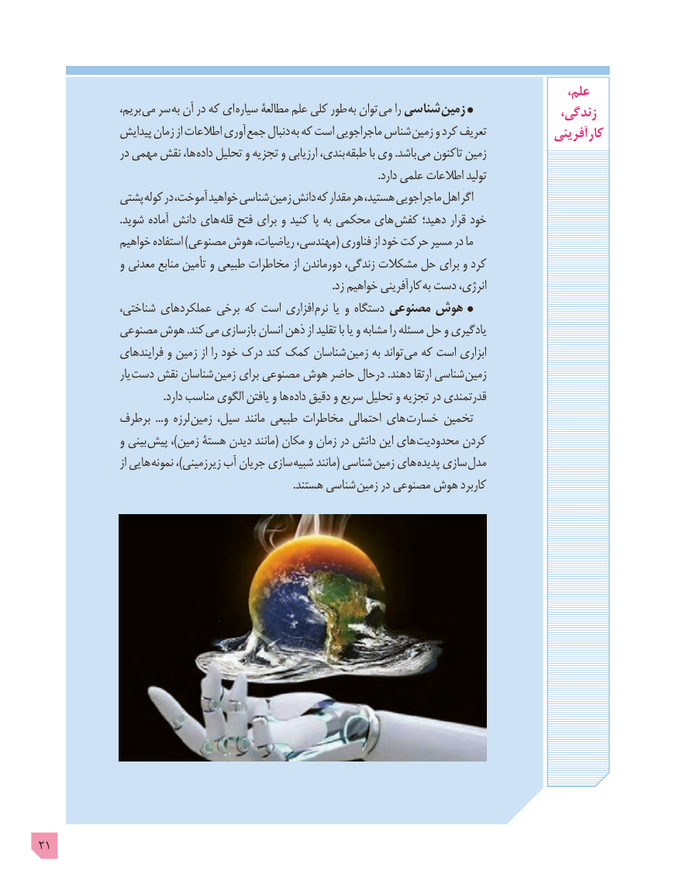

# PDF page 21

،علم
                   ،بریم می سر به آن در که ای سیاره مطالعۀ علم کلی طور به توان می را شناسی زمین                زندگی،
               پیدایش زمان از اطالعات آوری  جمع دنبال  به که است ماجراجویی شناس  زمین و کرد تعریف            آفرینی  کار
                 در مهمی نقش ،ها داده تحلیل و تجزیه و ارزیابی ،بندی طبقه با وی .باشد می تاکنون زمین
                                                                                                                                 .دارد علمی اطالعات تولید
              پشتی کوله در ،آموخت خواهید شناسی زمین دانش که مقدار هر ،هستید ماجراجویی اهل اگر
                               .شوید آماده دانش های قله فتح برای و کنید پا به محکمی های کفش دهید؛ قرار خود
                خواهیم استفاده )مصنوعی هوش ،ریاضیات ،مهندسی( فناوری از خود حرکت مسیر در ما
                 و معدنی منابع تأمین و طبیعی مخاطرات از دورماندن ،زندگی مشکالت حل برای و کرد
                                                                                                               .زد خواهیم کارآفرینی  به دست ،انرژی
                ،شناختی عملکردهای برخی که است افزاری نرم یا و دستگاه مصنوعی هوش
             مصنوعی هوش .کند می بازسازی انسان ذهن از تقلید با یا و مشابه را مسئله حل و یادگیری
                 فرایندهای و زمین از را خود درک کند کمک شناسان  زمین به تواند می که است ابزاری
                      یار  دست نقش شناسان  زمین برای مصنوعی هوش حاضر درحال .دهند ارتقا شناسی  زمین
                                               .دارد مناسب الگوی یافتن و ها داده دقیق و سریع تحلیل و تجزیه در قدرتمندی
             برطرف  ...و لرزه  زمین ،سیل مانند طبیعی مخاطرات احتمالی های خسارت تخمین
                 و بینی پیش ،)زمین هستۀ دیدن مانند( مکان و زمان در دانش این های محدودیت کردن
                         از هایی نمونه ،)زیرزمینی آب جریان سازی  شبیه مانند( شناسی  زمین های پدیده سازی مدل
                                                                                                .هستند شناسی  زمین در مصنوعی هوش کاربرد

21

