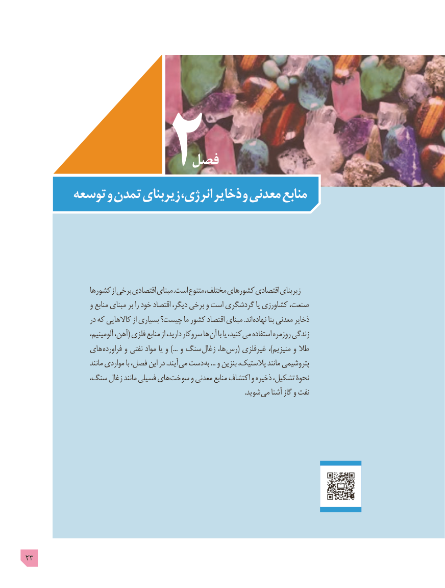

# PDF page 23

فصل
       توسعه و تمدن زیربنای انرژی، ذخایر و معدنی منابع

                  کشورها از برخی اقتصادی مبنای .است متنوع مختلف، کشورهای اقتصادی زیربنای
                    و منابع مبنای بر را خود اقتصاد دیگر، برخی و است گردشگری یا کشاورزی صنعت،
                     در که کاالهایی از بسیاری چیست؟ ما کشور اقتصاد مبنای .اند نهاده بنا معدنی ذخایر
                        آلومینیم، آهن،( فلزی منابع از دارید، سروکار ها آن با یا کنید، می استفاده روزمره زندگی
               های فراورده و نفتی مواد یا و ...) و سنگ زغال ها، رس( غیرفلزی ،)منیزیم و طال
                        مانند مواردی با فصل، این در .آیند می دست به ... و بنزین پالستیک، مانند پتروشیمی
               سنگ، زغال مانند فسیلی های سوخت و معدنی منابع اکتشاف و ذخیره تشکیل، نحوۀ
                                                                                                                              .شوید می آشنا گاز و نفت

23

