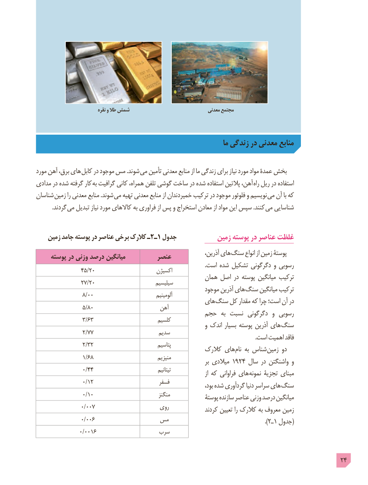

# PDF page 24

نقره و طال شمش                                معدنی مجتمع

                                                                    ما زندگی در معدنی منابع

مورد آهن برق، های کابل در موجود مس .شوند می تأمین معدنی منابع از ما زندگی برای نیاز مورد مواد عمدۀ بخش
مدادی در شده گرفته کار  به گرافیت کانی همراه، تلفن گوشی ساخت در شده استفاده پالتین آهن، راه ریل در استفاده
شناسان  زمین را معدنی  منابع .شوند  می تهیه معدنی منابع از خمیردندان ترکیب در موجود فلوئور و نویسیم می آن با که
  . گردند می تبدیل نیاز مورد کاالهای به فراوری از پس و استخراج معادن از مواد این سپس .کنند  می شناسایی

    زمین جامد پوسته در عناصر برخی کالرک ١ـ٢ـ جدول            زمین پوسته در عناصر غلظت
                                                                     آذرین، های سنگ انواع از زمین پوستۀ     پوسته در وزنی درصد میانگین         عنصر
                                                                                                                     .است شده تشکیل دگرگونی و رسوبی                45/20                       اکسیژن
                                                     همان اصل در پوسته میانگین ترکیب                27/20                        سیلیسیم                                                           موجود آذرین های سنگ میانگین ترکیب                 8/00                               آلومینیم                                                 های سنگ کل مقدار که چرا است؛ آن در                 5/80                       آهن                                          حجم  به نسبت دگرگونی  و رسوبی                 3/63                        کلسیم                                                                و اندک بسیار پوسته آذرین های سنگ
                 2/77                       سدیم                                                                                                                                                         .است اهمیت فاقد
                 2/32                            پتاسیم                                                  کالرک های نام به شناس زمین دو
                 1/68                            منیزیم                                                                              بر میالدی ١٩٢٤ سال در واشنگتن و
                 0/44                                  تیتانیم                                                                                                 از که فراوانی های نمونه تجزیۀ مبنای
                 0/12                         فسفر                                                                                بود، شده گردآوری دنیا سراسر های سنگ
                 0/10                            منگنز                                                              پوستۀ سازنده عناصر وزنی درصد میانگین
                0/007                     روی              کردند تعیین را کالرک به معروف زمین
                0/006              مس                                                           ).٢ـ١ جدول(
               0/0016                 سرب

                                                                                            24

