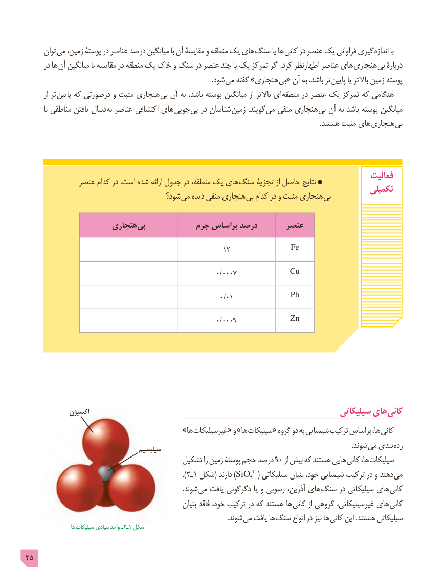

# PDF page 25

توان  می زمین، پوستۀ در عناصر درصد میانگین با آن مقایسۀ و منطقه یک های سنگ یا ها کانی در عنصر یک فراوانی گیری اندازه با
      در ها آن میانگین با مقایسه در منطقه یک خاک و سنگ در عنصر چند یا یک تمرکز اگر .کرد اظهارنظر عناصر های  هنجاری بی دربارۀ
                        . شود می گفته »هنجاری  بی« آن به باشد، تر  پایین یا باالتر زمین پوسته
        از تر  پایین که درصورتی و مثبت هنجاری بی آن به باشد، پوسته میانگین از باالتر ای  منطقه در عنصر یک تمرکز که هنگامی
          با مناطقی یافتن دنبال به عناصر اکتشافی های  جویی پی در شناسان  زمین .گویند می منفی هنجاری بی آن به باشد پوسته میانگین
                                                                                                                                                                         .هستند مثبت های هنجاری بی

                                                                                           فعالیت             عنصر کدام در .است شده ارائه جدول در منطقه، یک های سنگ تجزیۀ از حاصل نتایج                                                                                       تکمیلی                                      شود؟ می دیده منفی هنجاری  بی کدام در و مثبت هنجاری بی

                     هنجاری بی           جرم براساس درصد       عنصر

                                                      12              Fe

                                                       0/0007           Cu

                                                          0/01             Pb

                                                       0/0009           Zn

             اکسیژن                                                                سیلیکاتی های کانی
                                    »ها غیرسیلیکات« و »ها سیلیکات« گروه دو به شیمیایی ترکیب براساس ها،  کانی
                                                                                                                                                                                           .شوند می بندی رده                                   سیلیسیم
                                       تشکیل را زمین پوستۀ حجم درصد ٩٠ از بیش که هستند هایی کانی ها، سیلیکات
                                                                               ). ٢ـ1 شکل( دارند )SiO44-( سیلیکاتی بنیان خود، شیمیایی ترکیب در و دهند می
                                                                                          .شوند می یافت دگرگونی یا و رسوبی آذرین، های سنگ در سیلیکاتی های کانی
                                                        بنیان فاقد خود، ترکیب در که هستند ها کانی از گروهی غیرسیلیکاتی، های کانی
                                                                                                                    .شوند می یافت ها سنگ انواع در نیز ها کانی این .هستند سیلیکاتی
                    ها سیلیکات٢ـبنیادی واحد ـ  1 شکل

25

