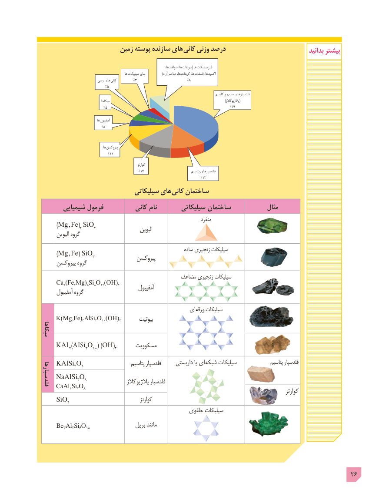

# PDF page 26

زمین پوسته سازنده های  کانی وزنی درصد                                 بدانید بیشتر

                              ،ها،سولفیدها     سولفات( ها  غیرسیلیکات
                                                            ها  سیلیکات سایر  ) آزاد عناصر ها، کربنات ها،  فسفات اکسیدها،
                            رسی های کانی         %3                           %8
                                  %5
                                                                                                          کلسیم و سدیم فلدسپارهای
                                            میکاها                                                                                                               )پالژیوکالز(
                                  %5                                                                  %39

                                        ها آمفیبول
                                 %5

                                             ها پیروکسن
                                    %11
                                                                           کوارتز
                                                    %12                                  پتاسیم فلدسپارهای
                                                                                     %12
                              سیلیکاتی های کانی ساختمان
       شیمیایی فرمول          کانی نام        سیلیکاتی ساختمان             مثال
                                                                            منفرد      )Mg , Fe(2 SiO4                                                الیوین       الیوین گروه
                                                               ساده زنجیری سیلیکات      )Mg , Fe( SiO3                                   پیروکسن      پیروکسن گروه
                                             مضاعف زنجیری سیلیکات
     Ca2(Fe,Mg)5Si8O22(OH)2                                           آمفیبول       آمفیبول گروه
                                                      ای ورقه سیلیکات
     K(Mg,Fe)3AlSi3O10(OH)2       بیوتیت
میکاها
     KAl 2)AISi3O10( )OH(2      مسکوویت
    KAlSi3O8                     پتاسیم فلدسپار      داربستی یا ای شبکه سیلیکات                پتاسیم فلدسپار
    NaAlSi3O8فلدسپارها                                 پالژیوکالز فلدسپار
     CaAl2Si2O8                                                                                             کوارتز
     SiO2                                  کوارتز
                                                   حلقوی سیلیکات
     Be3Al2Si6O18                  بریل مانند

                                                                                           26

