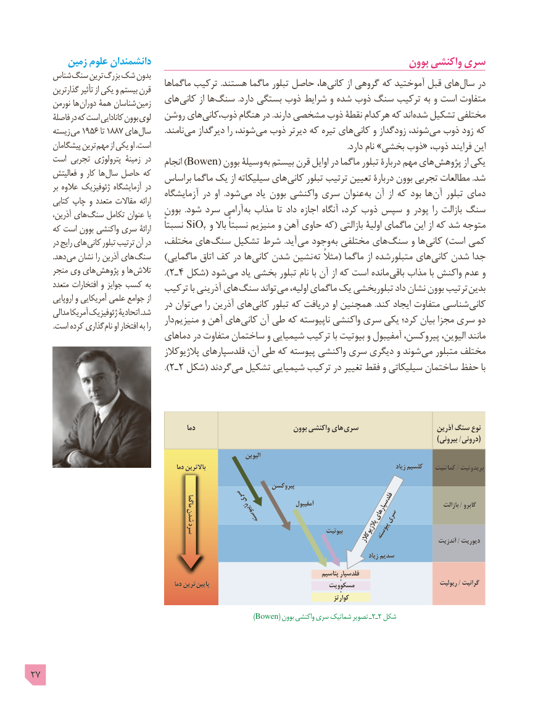

# PDF page 27

زمین علوم دانشمندان                                                    بوون واکنشی سری
     شناس سنگ ترین بزرگ شک بدون                                   ماگماها ترکیب .هستند ماگما تبلور حاصل ها، کانی از گروهی که آموختید قبل های سال در       گذارترین تأثیر از یکی و بیستم قرن
      نورمن ها دوران همۀ شناسان زمین   های کانی از ها سنگ .دارد بستگی ذوب شرایط و شده ذوب سنگ ترکیب به و است متفاوت
      فاصلۀ در که است کانادایی بوون لوی   روشن های کانیذوب، هنگام در .دارند مشخصی ذوب نقطۀ هرکدام که اند شده تشکیل مختلفی
      زیسته می 1956 تا 1887 های سال       .نامند می دیرگداز را شوند، می ذوب دیرتر که تیره های کانی و زودگداز شوند، می ذوب زود که
      پیشگامان ترین مهم از یکی او .است                                                                                                    .دارد نام »بخشی ذوب« ذوب، فرایند این
     است تجربی پترولوژی زمینۀ در                                      انجام )Bowen( بوون وسیلۀ به بیستم قرن اوایل در ماگما تبلور دربارۀ مهم های پژوهش از یکی
      فعالیتش و کار ها سال حاصل که                             براساس ماگما یک از سیلیکاته های کانی تبلور ترتیب تعیین دربارۀ بوون تجربی مطالعات .شد        بر عالوه ژئوفیزیک آزمایشگاه در                                   آزمایشگاه در او  .شود می یاد بوون واکنشی سری عنوان به آن از که بود ها آن تبلور دمای       کتابی چاپ و متعدد مقاالت ارائه
                                بوون  .شود سرد آرامی به مذاب تا داد اجازه آنگاه کرد، ذوب سپس و پودر را بازالت سنگ       آذرین، های سنگ تکامل عنوان با
     که است بوون واکنشی سری ارائۀ    نسبتاً SiO2 و باال نسبتاً منیزیم و آهن حاوی که( بازالتی اولیۀ ماگمای این از که شد متوجه
       در رایج های کانی تبلور ترتیب آن در   مختلف، های سنگ تشکیل شرط  .آید می وجود به مختلفی های سنگ و ها کانی )است کمی
            .دهد می نشان را آذرین های سنگ    )ماگمایی اتاق کف در ها کانی شدن نشین ته مثالً( ماگما از متبلورشده های کانی شدن جدا
      منجر وی های پژوهش و ها تالش                                                   ).٢ـ٤ شکل( شود می یاد بخشی تبلور نام با آن از که است مانده باقی مذاب با واکنش عدم و
       متعدد افتخارات و جوایز کسب به                            ترکیب با آذرینی های سنگ تواند می اولیه، ماگمای یک تبلوربخشی داد نشان بوون ترتیب بدین        اروپایی و آمریکایی علمی جوامع از                                در توان می را آذرین های کانی تبلور که دریافت او همچنین .کند ایجاد متفاوت شناسی کانی       مدالی آمریکا ژئوفیزیک اتحادیۀ .شد                                        دار منیزیم و آهن های کانی آن طی که ناپیوسته واکنشی سری یکی کرد؛ بیان مجزا سری دو            .است کرده گذاری نام او افتخار به را
                              دماهای در متفاوت ساختمان و شیمیایی ترکیب با بیوتیت و آمفیبول پیروکسن، الیوین، مانند
                                      پالژیوکالز فلدسپارهای آن، طی که پیوسته واکنشی سری دیگری و شوند می متبلور مختلف
                                                   ). ٢ـ٢ شکل( گردند می تشکیل شیمیایی ترکیب در تغییر فقط و سیلیکاتی ساختمان حفظ با

                                                        دما                             بوون واکنشی های سری                        آذرین سنگ نوع
                                                                                                                                                                         )بیرونی /درونی(
                                                                                    الیوین
                                                          دما باالترین                                                                              زیاد کلسیم    کماتئیت / پریدوتیت
                                                                        پیروکسن
                                                                 ماگما                                   سری                  آمفیبول                       فلدسپارهای                                       شدن                                                                              ناپیوسته                     سری                 بازالت / گابرو
                                       سرد                                              بیوتیت                                                                                                            پیوسته                                                                                                                                                 پالژیوکالز                   آندزیت / دیوریت
                                                                                                                                           زیاد سدیم
                                                                                                      پتاسیم فلدسپار
                                                                                                                      +                                  ریولیت / گرانیت                                                          دما ترین  پایین                                 مسکوویت
                                                                                                                      +
                                                                                                                     کوارتز
                                                         )Bowen( بوون٢ـواکنشی سری شماتیک تصویر ـ  2 شکل

27

