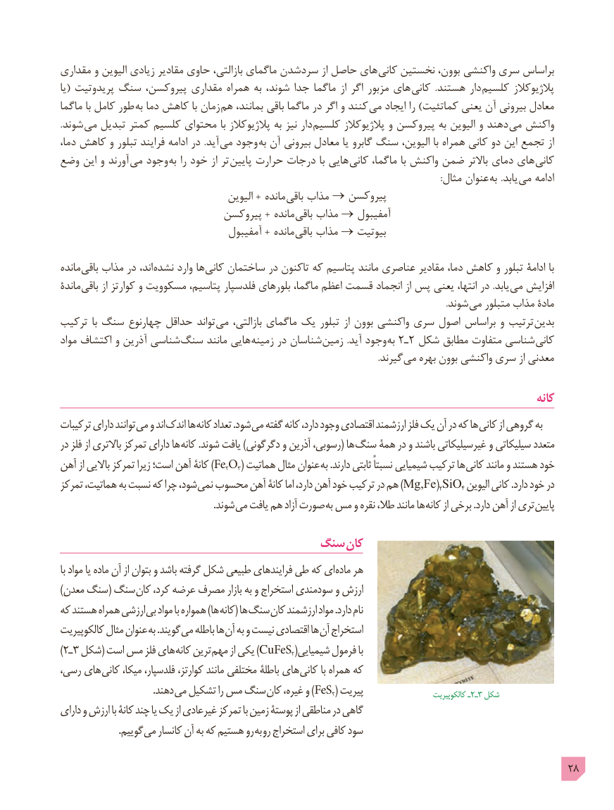

# PDF page 28

مقداری و الیوین زیادی مقادیر حاوی بازالتی، ماگمای سردشدن از حاصل های  کانی نخستین بوون، واکنشی سری براساس
یا( پریدوتیت سنگ پیروکسن، مقداری همراه به شوند، جدا ماگما از اگر مزبور های  کانی  .هستند دار کلسیم پالژیوکالز
ماگما با کامل طور  به دما کاهش با زمان  هم بمانند، باقی ماگما در اگر و کنند  می ایجاد را )کماتئیت یعنی آن بیرونی معادل
.شوند می تبدیل کمتر کلسیم محتوای با پالژیوکالز به نیز دار کلسیم پالژیوکالز و پیروکسن به الیوین و دهند می واکنش
دما، کاهش و تبلور فرایند ادامه در  .آید می وجود به آن بیرونی معادل یا گابرو سنگ الیوین، با همراه کانى دو این تجمع از
وضع این و آورند  مى وجود به را خود از تر  پایین حرارت درجات با هایى کانى ماگما، با واکنش ضمن باالتر دمای های کانی
               : مثال عنوان به .یابد  مى ادامه
                                        الیوین + مانده  باقی مذاب → پیروکسن
                              پیروکسن + مانده  باقی مذاب → آمفیبول
                                   آمفیبول + مانده  باقی مذاب → بیوتیت

مانده باقی مذاب در اند، نشده وارد ها کانی ساختمان در تاکنون که پتاسیم مانند عناصرى مقادیر دما، کاهش و تبلور ادامۀ با
ماندۀ باقی از کوارتز و مسکوویت پتاسیم، فلدسپار بلورهاى ماگما، اعظم قسمت انجماد از پس یعنى انتها، در .یابد می افزایش
                                                                                                                                                                            .شوند می متبلور مذاب مادۀ
ترکیب  با سنگ چهارنوع حداقل تواند می بازالتی، ماگمای یک تبلور از بوون واکنشی سری اصول براساس و ترتیب بدین
مواد اکتشاف و آذرین شناسی سنگ مانند هایی زمینه در شناسان زمین  .آید وجود به 2ـ٢ شکل مطابق متفاوت شناسى کانى
                      . گیرند می بهره بوون واکنشی سری از معدنی

                                                                                                        کانه
ترکیبات دارای توانند می و اند اندک ها کانه تعداد .شود می گفته کانه دارد، وجود اقتصادی ارزشمند فلز یک آن در که ها کانی از گروهی به
در فلز از باالتری تمرکز دارای ها کانه .شوند یافت )دگرگونی و آذرین رسوبی،( ها سنگ همۀ در و باشند غیرسیلیکاتی و سیلیکاتی متعدد
آهن از باالیی تمرکز زیرا است؛ آهن کانۀ )Fe2O3( هماتیت مثال عنوان به .دارند ثابتی نسبتاً شیمیایی ترکیب ها کانی مانند و هستند خود
تمرکز هماتیت، به نسبت که چرا شود، نمی محسوب آهن کانۀ اما دارد، آهن خود ترکیب در هم (Mg,Fe)2SiO4 الیوین کانی .دارد خود در
             . شوند می یافت هم آزاد صورت به مس و نقره طال، مانند ها کانه از برخی .دارد آهن از تری پایین

                               سنگ کان
با مواد یا ماده آن از بتوان و باشد گرفته شکل طبیعی فرایندهای طی که ای ماده هر
)معدن سنگ( سنگ کان کرد، عرضه مصرف بازار به و استخراج سودمندی و ارزش
که هستند همراه ارزشی بی مواد با همواره )ها کانه( ها سنگ کان ارزشمند مواد .دارد نام
کالکوپیریت مثال عنوان به .گویند می باطله ها آن به و نیست اقتصادی ها آن استخراج
) ٢ـ 3 شکل( است مس فلز های کانه ترین )مهم از یکی CuFeS2(شیمیایی فرمول با
رسی، های کانی میکا، فلدسپار، کوارتز، مانند مختلفی باطلۀ های کانی با همراه که
        . دهند می تشکیل را مس سنگ )کان غیره، و FeS2( پیریت                  کالکوپیریت٢ــ  3 شکل
دارای و ارزش با کانۀ چند یا یک از غیرعادی تمرکز با زمین پوستۀ از مناطقی در گاهی
    . گوییم می کانسار آن به که هستیم رو به رو استخراج برای کافی سود

                                                                                            28

