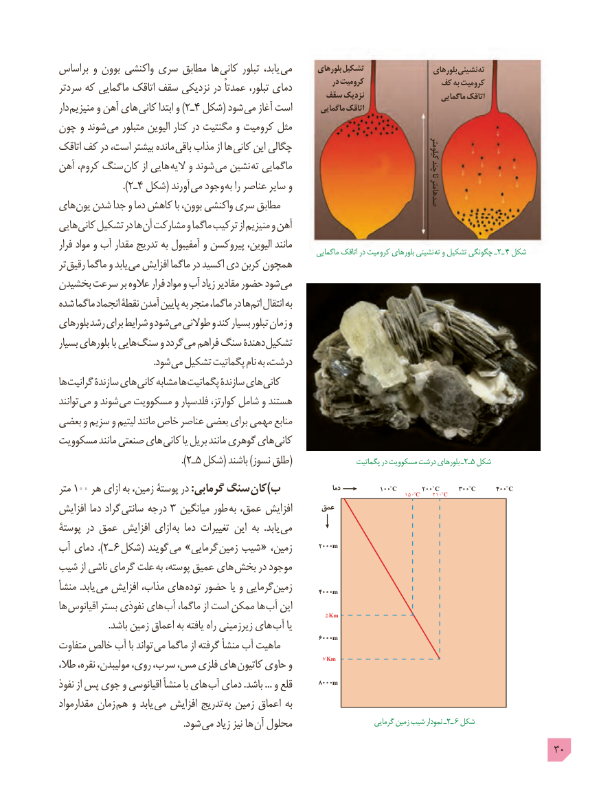

# PDF page 30

براساس و بوون واکنشی سری مطابق ها  کانی تبلور یابد، می       بلورهای تشکیل                    بلورهای نشینی ته
سردتر که ماگمایی اتاقک سقف نزدیکی در عمدتاً تبلور، دمای            در کرومیت              کف به کرومیت                                                 سقف نزدیک                      ماگمایی اتاقک
دار منیزیم و آهن های )کانی٢ـابتدا و   4 شکل( شود می آغاز است        ماگمایی اتاقک
چون و شوند  می متبلور الیوین کنار در مگنتیت و کرومیت مثل
اتاقک کف در است، بیشتر مانده  باقی مذاب از ها  کانی این چگالی                                                                                                                                                                              کیلومتر
                                                                          چندآهن کروم، سنگ  کان از هایی الیه و شوند  می نشین  ته ماگمایی                  تا
                        ). ٢ـ4 شکل( آورند  می وجود به را عناصر سایر و                                                                                                                                                                              صدهامترهای یون شدن جدا و دما کاهش با بوون، واکنشی سری مطابق
هایی کانی تشکیل در ها آن مشارکت و ماگما ترکیب از منیزیم و آهن
فرار مواد و آب مقدار تدریج به آمفیبول و پیروکسن الیوین، مانند                                                                               ماگمایی اتاقک در کرومیت بلورهای نشینی  ته٢ـو تشکیل چگونگی ـ    4 شکل
تر رقیق ماگما و یابد می افزایش ماگما در اکسید دی کربن همچون
بخشیدن سرعت بر عالوه فرار مواد و آب زیاد مقادیر حضور شود می
شده ماگما انجماد نقطۀ آمدن پایین به منجر ماگما، در ها اتم انتقال به
بلورهای رشد برای شرایط و شود می طوالنی و کند بسیار تبلور زمان و
بسیار بلورهای با هایی سنگ و گردد می فراهم سنگ دهندۀ تشکیل
         . شود می تشکیل پگماتیت نام به درشت،
ها گرانیت سازندۀ های کانی مشابه ها پگماتیت سازندۀ های کانی
توانند می و شوند می مسکوویت و فلدسپار کوارتز، شامل و هستند
بعضی و سزیم و لیتیم مانند خاص عناصر بعضی برای مهمی منابع
مسکوویت مانند صنعتی های کانی یا بریل مانند گوهری های کانی
                                              ).٢ـ5 شکل( باشند )نسوز طلق(     پگماتیت٢ـدر مسکوویت درشت بلورهای ـ  5 شکل

                                                                                                    دما             100 C        200 C      300 C       400 Cمتر 100 هر ازای به زمين، پوستۀ در :گرمابی سنگ کان)ب                                              150C     210 C
                                                             عمقافزايش دما گراد سانتی درجه 3 میانگین طور  به عمق، افزايش
پوستۀ در عمق افزایش ازای  به دما تغييرات اين به  .يابد می

                                                                          2000mآب دمای ).٢ـ 6 شکل( گويند می »گرمايی زمين شيب « ،زمین
شیب از ناشی گرمای علت به پوسته، عمیق های  بخش در موجود
منشأ .یابد  می افزایش مذاب، های توده حضور یا و گرمایی زمین       4000m
ها اقیانوس بستر نفوذی های آب ماگما، از است ممکن ها آب این          5 Km
 . باشد زمین اعماق به یافته راه زیرزمینی های آب یا
متفاوت خالص آب با تواند  می ماگما از گرفته منشأ آب ماهیت           6000m
                                                                                   7 Km
طال، نقره، مولیبدن، روی، سرب، مس، فلزی های  کاتیون حاوی و
                                                                          8000mنفوذ از پس جوی و اقیانوسی منشأ با های آب دمای .باشد ... و قلع
مقدارمواد زمان  هم و یابد  می افزایش تدریج  به زمین اعماق به
                                                     .شود می زیاد نیز ها  آن محلول        گرمایی٢ـزمین شیب نمودار ـ    6 شکل
                                                                                            30

