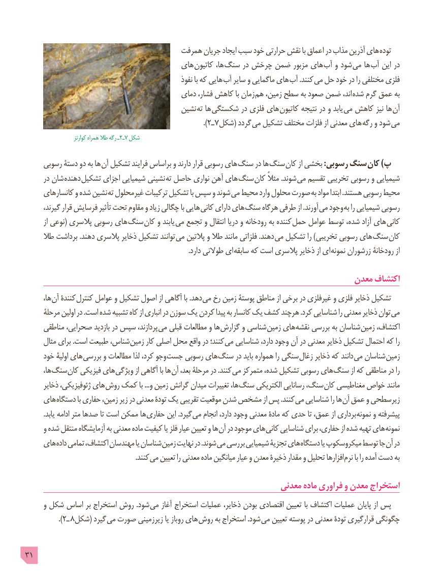

# PDF page 31

همرفت جریان ایجاد سبب خود حرارتی نقش با اعماق در مذاب آذرین های توده
                                     های کاتیون ها، سنگ در چرخش ضمن مزبور های آب و شود  می ها آب این در
                                                       نفوذ با که هایی آب سایر و ماگمایی های آب .کنند می حل خود در را مختلفی فلزی
                                          دمای فشار، کاهش با زمان  هم زمین، سطح به صعود ضمن اند،  شده گرم عمق به
                                         نشین  ته ها شکستگی در فلزی های  کاتیون نتیجه در و یابد  می کاهش نیز ها آن
                                                                                         ).٢ـ 7شکل( گردد می تشکیل مختلف فلزات از معدنی های  رگه و شود می
        کوارتز٢ـهمراه طال رگه ـ  7 شکل

     رسوبی دستۀ دو به ها آن تشکیل فرایند براساس و دارند قرار رسوبی های سنگ در ها سنگ کان از بخشی :رسوبی سنگ کان )پ
      در شان  دهنده تشکیل اجزای شیمیایی نشینی  ته حاصل نواری آهن های سنگ کان مثالً .شوند می تقسیم تخریبی رسوبی و شیمیایی
     کانسارهای و شده نشین ته غیرمحلول ترکیبات تشکیل با سپس و شوند  می محیط وارد محلول صورت به مواد ابتدا .هستند رسوبی محیط
      گیرند، قرار فرسایش تأثیر تحت مقاوم و زیاد چگالی با هایی  کانی دارای های سنگ هرگاه طرفی از .آورند  می وجود به را شیمیایی رسوبی
        از نوعی( پالسری رسوبی های سنگ کان و یابند  می تجمع و انتقال دریا و رودخانه به کننده حمل عوامل توسط شده، آزاد های  کانی
     طال برداشت .دهند پالسری ذخایر تشکیل توانند  می پالتین و طال مانند فلزاتی .دهند می تشکیل را )تخریبی رسوبی های سنگ کان
                                                                                              .دارد طوالنی ای سابقه که است پالسری ذخایر از ای  نمونه زرشوران رودخانۀ از

                                                                       معدن اکتشاف
       ها، آن کنندۀ کنترل عوامل و تشکیل اصول از آگاهی با .دهد می رخ زمین پوستۀ مناطق از برخی در غیرفلزی و فلزی ذخاير تشکیل
     مرحلۀ اولین در .است شده تشبیه کاه از انباری در سوزن یک کردن پیدا به کانسار یک کشف هرچند .کرد شناسایی را معدنی ذخایر توان می
     مناطقی صحرایی، بازدید در سپس پردازند، می قبلی مطالعات و ها گزارش و شناسی زمین های نقشه بررسی به شناسان زمین اکتشاف،
      مثال برای .است طبیعت شناس، زمین کار اصلی محل واقع در کنند؛ می شناسایی دارد، وجود آن در معدنی ذخایر تشکیل احتمال که را
     خود اولیۀ های بررسی و مطالعات لذا کرد، وجو جست رسوبی های سنگ در باید همواره را سنگی زغال ذخایر که دانند می شناسان زمین
       ها، سنگ کان فیزیکی های ویژگی از آگاهی با ها آن بعد، مرحلۀ در .کنند می متمرکز شده، تشکیل رسوبی های سنگ از که مناطقی در را
      ذخایر ژئوفیزیکی، های روش کمک با ...و زمین گرانش میدان تغییرات ها، سنگ الکتریکی رسانایی سنگ، کان مغناطیسی خواص مانند
    های دستگاه با حفاری زمین، زیر در معدنی تودۀ یک تقریبی موقعیت شدن مشخص از پس .کنند می شناسایی را ها آن عمق و زیرسطحی
          .یابد ادامه متر صدها تا است ممکن ها حفاری این .گیرد می انجام دارد، وجود معدنی مادۀ که حدی تا عمق، از برداری نمونه و پیشرفته
      و شده منتقل آزمایشگاه به معدنی ماده کیفیت یا فلز عیار تعیین و ها آن در موجود های کانی شناسایی برای حفاری، از شده تهیه های نمونه
    های داده تمامی اکتشاف، مهندسان یا شناسان زمین نهایت در .شوند می بررسی شیمیایی تجزیۀ های دستگاه یا میکروسکوپ توسط جا آن در
              . کنند می تعیین را معدنی ماده میانگین عیار و معدن ذخیرۀ مقدار و تحلیل افزارها نرم با را آمده دست به

                                                            معدنی ماده فراوری و معدن استخراج
      و شکل اساس بر استخراج روش .شود می آغاز استخراج عمليات ذخاير، بودن اقتصادی تعیین با اكتشاف عملیات پایان از پس
                 ).٢ـ 8شکل( گیرد می صورت زیرزمینی یا روباز های  روش به استخراج .شود می تعیین پوسته در معدنی تودۀ قرارگیری چگونگی

31

