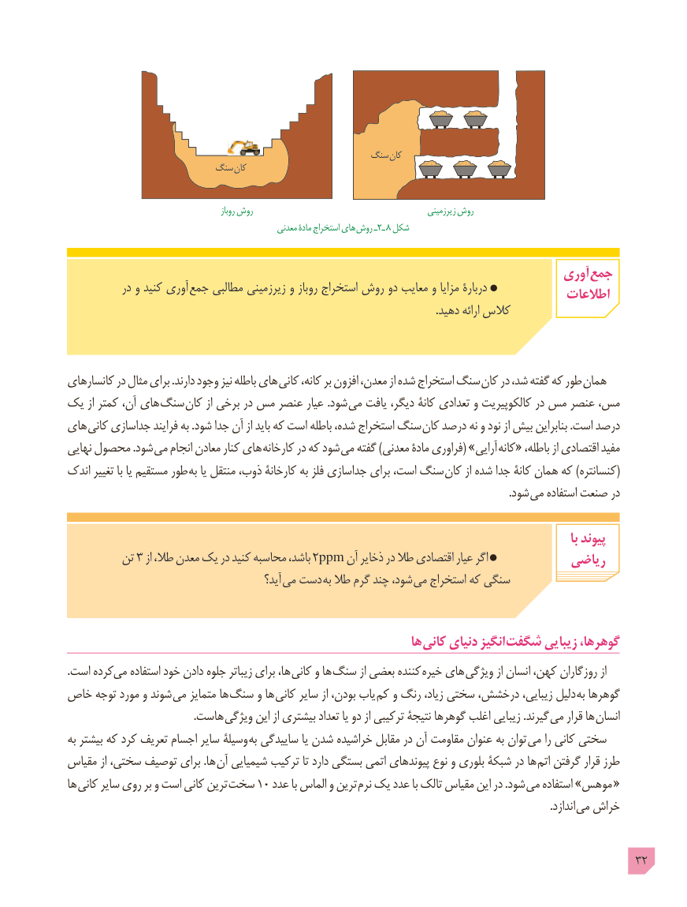

# PDF page 32

سنگ کان
                         سنگ کان

                                                      روباز روش                                                 زیرزمینی روش
                                                     معدنی مادۀ استخراج های روش٢ــ    8 شکل

                                                                             آوری جمع            در و کنید آوری جمع مطالبی زیرزمینی و روباز استخراج روش دو معایب و مزایا دربارۀ                                                                                 اطالعات
                                                                                                                                         .دهید ارائه کالس

کانسارهای در مثال برای .دارند وجود نیز باطله های  کانی کانه، بر افزون معدن، از شده استخراج سنگ کان در شد، گفته که طور همان
یک از کمتر آن، های سنگ  کان از برخی در مس عنصر عیار .شود  می یافت دیگر، کانۀ تعدادی و کالکوپیریت در مس عنصر مس،
های  کانی جداسازی فرایند به .شود جدا آن از باید که است باطله شده، استخراج سنگ کان درصد نه و نود از بیش بنابراین .است درصد
نهایی محصول .شود می انجام معادن کنار های کارخانه در که شود می گفته )معدنی مادۀ فراوری( »آرایی  کانه« باطله، از اقتصادی مفید
اندک تغییر با یا مستقیم طور به یا منتقل ذوب، کارخانۀ به فلز جداسازی برای است، سنگ (کان از شده جدا کانۀ همان که )کنسانتره
                                     . شود می استفاده صنعت در

                                                                                                                                    با پیوند
         تن  3 از طال، معدن یک در کنید محاسبه باشد، 2ppm آن ذخایر در طال اقتصادی عیار اگر            ریاضی
                                              آید؟ می دست به طال گرم چند شود، می استخراج که سنگی

                                                               ها کانی دنیای انگیز  شگفت زیبایی گوهرها،
.است کرده می استفاده خود دادن جلوه زیباتر برای ها، کانی و ها سنگ از بعضی کننده خیره های ویژگی از انسان کهن، روزگاران از
خاص توجه مورد و شوند می متمایز ها سنگ و ها کانی سایر از بودن، یاب کم و رنگ زیاد، سختی درخشش، زیبایی، دلیل به گوهرها
                                               .هاست  ویژگی این از بیشتری تعداد یا دو از ترکیبی نتیجۀ گوهرها اغلب زیبایی .گیرند می قرار ها انسان
به بیشتر که کرد تعریف اجسام سایر وسیلۀ به ساییدگی یا شدن خراشیده مقابل در آن مقاومت عنوان به توان می را کانی سختی
مقیاس از سختی، توصیف برای .ها آن شیمیایی ترکیب تا دارد بستگی اتمی پیوندهای نوع و بلوری شبکۀ در ها اتم گرفتن قرار طرز
ها  کانی سایر روی بر و است کانی ترین سخت١٠ عدد با الماس و ترین نرم یک عدد با تالک مقیاس این در .شود می استفاده »موهس «
                                                                                                                                                                                    .اندازد می خراش

                                                                                            32

