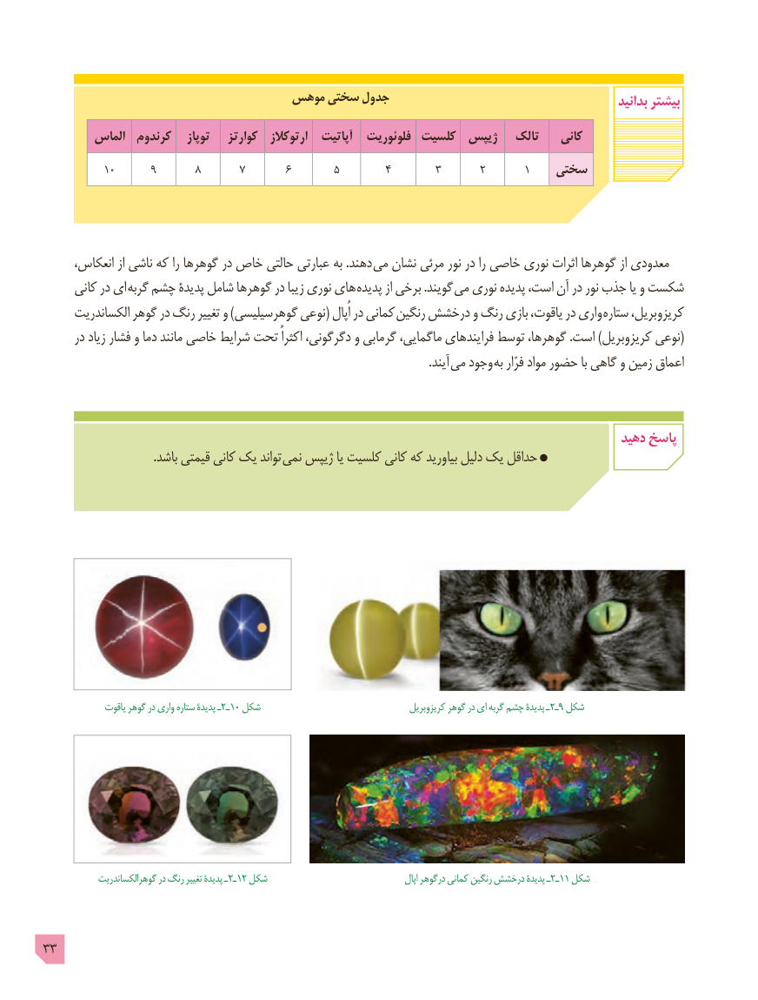

# PDF page 33

موهس سختی جدول                                              بدانید بیشتر
        الماس  کرندوم   توپاز    کوارتز   ارتوکالز   آپاتیت   فلوئوریت کلسیت  ژیپس   تالک    کانی
  ٨٩١٠       ٧       ٦       ٥        ٤        ٣       ٢   سختی١

 ،دهندانعکاس از ناشی که را گوهرها در خاص حالتی عبارتی به .       می نشان مرئی نور در را خاصی نوری اثرات گوهرها از معدودی
     کانی در ای گربه چشم پدیدۀ شامل گوهرها در زیبا نوری های پدیده از برخی .گویند می نوری پدیده است، آن در نور جذب یا و شکست
      الکساندریت گوهر در رنگ تغییر و )گوهرسیلیسی نوعی( اُپال در کمانی رنگین درخشش و رنگ بازی یاقوت، در واری ستاره کریزوبریل،
      در زیاد فشار و دما مانند خاصی شرایط تحت اکثراً دگرگونی، و گرمابی ماگمایی، فرایندهای توسط گوهرها، .است )کریزوبریل نوعی(
                                                                                                                                  .آیند  می وجود به فرّار مواد حضور با گاهی و زمین اعماق

                                                                                             دهید پاسخ
                                     .باشد قیمتی کانی یک تواند  نمی ژیپس یا کلسیت کانی که بیاورید دلیل یک حداقل

   یاقوت٢ـگوهر در واری ستاره پدیدۀ ـ  10 شکل          کریزوبریل٢گوهر در ای گربه چشم پدیدۀ ـ ـ9 شکل

      گوهرالکساندریت٢ـ١در رنگ تغییر پدیدۀ ـ   2 شکل      اپال٢ـ١درگوهر کمانی رنگین درخشش پدیدۀ ـ   1 شکل

33

