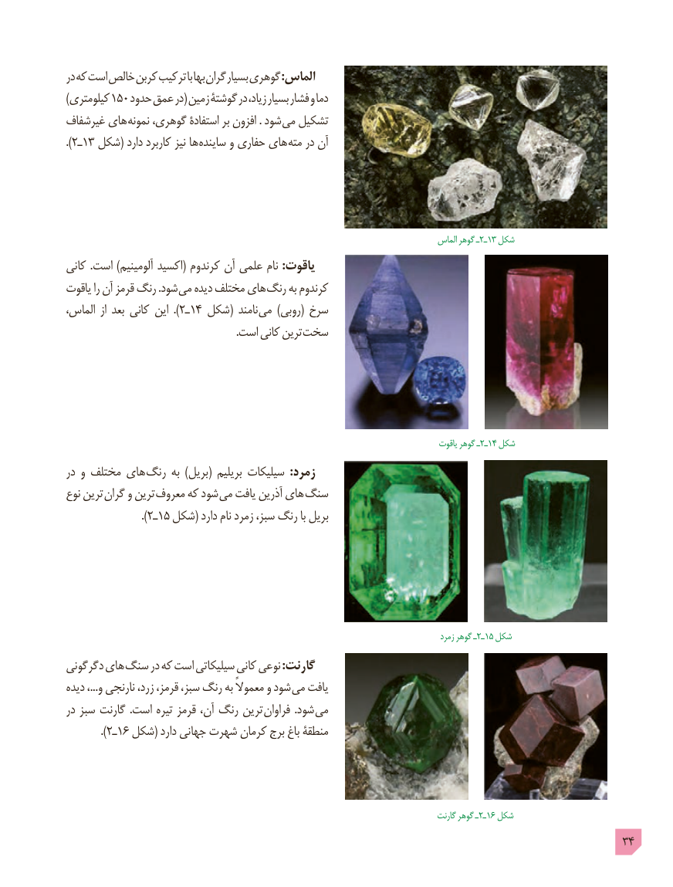

# PDF page 34

در که است خالص کربن ترکیب با بها گران بسیار گوهری :الماس
)کیلومتری 150 حدود عمق در( زمین گوشتۀ در زیاد، بسیار فشار و دما
غیرشفاف های نمونه گوهری، استفادۀ بر افزون . شود می تشکیل
).2ـ13 شکل( دارد کاربرد نیز ها ساینده و حفاری های مته در آن

                                                    الماس٢ـگوهر ـ  13 شکل
کانی .است )آلومینیم اکسید( کرندوم آن علمی نام :یاقوت
یاقوت را آن قرمز رنگ .شود می دیده مختلف های رنگ به کرندوم
الماس،  از بعد کانی این  ). 2ـ14 شکل( نامند می )روبی( سرخ
     . است کانی ترین سخت

                                                     یاقوت٢ـگوهر ـ  14 شکل
در و مختلف های  رنگ به  )بریل( بریلیم سیلیکات  :زمرد
نوع ترین گران و ترین معروف که شود می یافت آذرین های  سنگ
                   ).2ـ15 شکل( دارد نام زمرد سبز، رنگ با بریل

                                                  زمرد٢ـگوهر ـ  15 شکل
دگرگونی های سنگ در که است سیلیکاتی کانی نوعی :گارنت
دیده ،...و نارنجی زرد، قرمز، سبز، رنگ به معموالً و شود می یافت
در سبز گارنت  .است تیره قرمز آن، رنگ ترین  فراوان  .شود می
         ).2ـ16 شکل( دارد جهانی شهرت کرمان برج باغ منطقۀ

                                                     گارنت٢ـگوهر ـ  16 شکل
                                                                                            34

