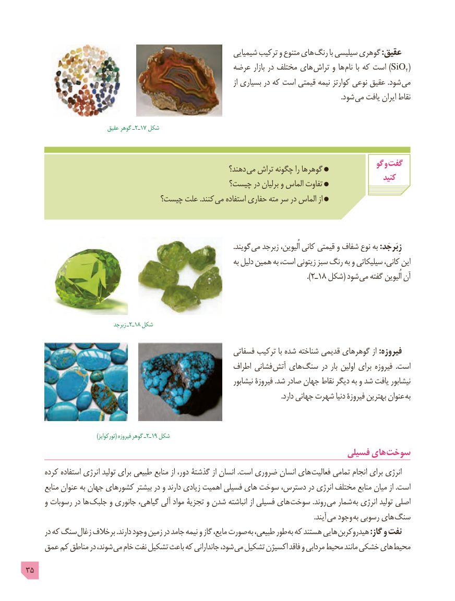

# PDF page 35

شیمیایی ترکیب و متنوع های رنگ با سیلیسی گوهری :عقیق
                                               عرضه بازار در مختلف های تراش و ها )نام با که است SiO2(
                                                                                              از بسیاری در که است قیمتی نیمه کوارتز نوعی عقیق .شود می
                                        . شود می یافت ایران نقاط

               عقیق٢ـگوهر ـ  17 شکل

                                                                                            گو و گفت                                                           دهند؟ می تراش چگونه را گوهرها
                                                                                                            کنید                                             چیست؟ در برلیان و الماس تفاوت
                              چیست؟ علت .کنند می استفاده حفاری مته سر در الماس از

                                                                                                                     .گویند می زبرجد اُلیوین، کانی قیمتی و شفاف نوع به :زِبَرجَد
                                                                        به دلیل همین به است، زیتونی سبز رنگ به و سیلیکاتی کانی، این
                                                                                                                                          ).2ـ18 شکل( شود می گفته اُلیوین آن

                              زبرجد٢ــ  18 شکل

                                                          فسفاتی ترکیب با شده شناخته قدیمی گوهرهای از :فیروزه
                                                          اطراف فشانی آتش های سنگ در بار اولین برای فیروزه  .است
                                                                         نیشابور فیروزۀ .شد صادر جهان نقاط دیگر به و شد یافت نیشابور
                                                                                                                                                .دارد جهانی شهرت دنیا فیروزۀ بهترین عنوان به

                                         )تورکوایز( فیروزه گوهر ـ ٢ـ19 شکل
                                                                        فسیلی های سوخت
     کرده استفاده انرژی تولید برای طبیعی منابع از دور، گذشتۀ از انسان .است ضروری انسان های فعالیت تمامی انجام برای انرژی
       منابع عنوان به جهان کشورهای بیشتر در و دارند زیادی اهمیت فسیلی های سوخت دسترس، در انرژی مختلف منابع میان از .است
      و رسوبات در ها جلبک و جانوری گیاهی، آلی مواد تجزیۀ و شدن انباشته از فسیلی های  سوخت .روند می شمار به انرژی تولید اصلی
                                       . آیند می وجود به رسوبی های سنگ
      در که سنگ زغال برخالف .دارند وجود زمین در جامد نیمه و گاز مایع، صورت به طبیعی، طور به که هستند هایی هیدروکربن :گاز و نفت
    عمق کم مناطق در شوند، می خام نفت تشکیل باعث که جاندارانی شود، می تشکیل اکسیژن فاقد و مردابی محیط مانند خشکی های محیط
35

