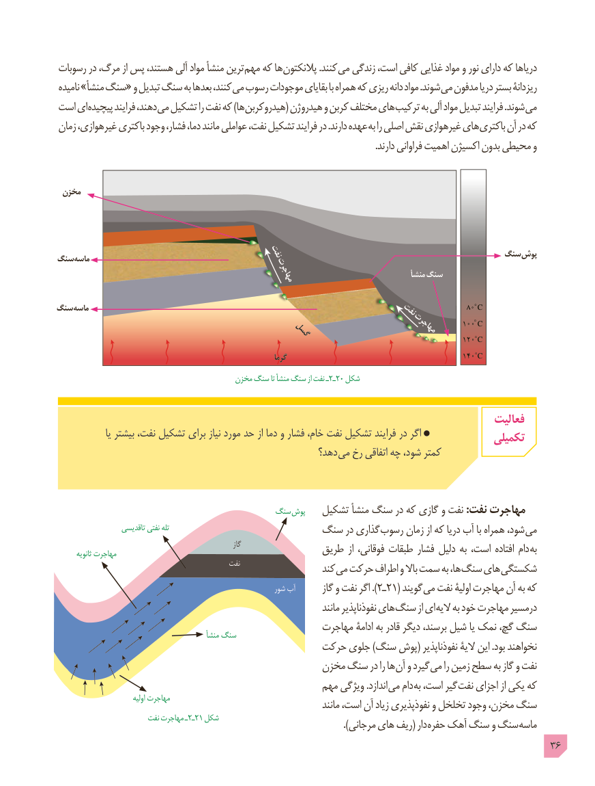

# PDF page 36

رسوبات در مرگ، از پس هستند، آلی مواد منشأ ترین مهم که ها پالنکتون .کنند می زندگی است، کافی غذایی مواد و نور دارای که دریاها
نامیده »منشأ سنگ« و تبدیل سنگ به بعدها کنند، می رسوب موجودات بقایای با همراه که ریزی دانه مواد .شوند می مدفون دریا بستر ریزدانۀ
است ای پیچیده فرایند دهند، می تشکیل را نفت که )ها هیدروکربن( هیدروژن و کربن مختلف های ترکیب به آلی مواد تبدیل فرایند .شوند می
زمان غیرهوازی، باکتری وجود فشار، دما، مانند عواملی نفت، تشکیل فرایند در .دارند عهده به را اصلی نقش غیرهوازی های باکتری آن در که
                                                                                                                                         .دارند فراوانی اهمیت اکسیژن بدون محیطی و

 مخزن

                                 نفت                                       سنگ پوشسنگ ماسه
                                                    مهاجرت                              منشأ سنگ

سنگ ماسه                                                نفت              80 C
                                                                                                                    100 C                                                                        مهاجرت                                 گسل                                                                                                               120 C
                                                                  گرما                                                140 C
           مخزن٢ـسنگ تا منشأ سنگ از نفت ـ  20 شکل

                                                                                       فعالیت
                 یا بیشتر نفت، تشکیل برای نیاز مورد حد از دما و فشار خام، نفت تشکیل فرایند در اگر                                                                                   تکمیلی
                                                       دهد؟ می رخ اتفاقی چه شود، کمتر

                                          سنگ  پوش   تشکیل منشأ سنگ در که گازی و نفت :نفت مهاجرت
                   تاقدیسی نفتی تله                      سنگ در گذاری رسوب زمان از که دریا آب با همراه شود، می
                                                               گاز               طریق از فوقانی، طبقات فشار دلیل به است، افتاده دام به        ثانویه مهاجرت
                                             نفت                  کند می حرکت اطراف و باال سمت به ها، سنگ های شکستگی
                                                           شور آب       گاز و نفت اگر ). ٢ـ21( گویند می نفت اولیۀ مهاجرت آن به که
                                                                            مانند نفوذناپذیر های سنگ از ای الیه به خود مهاجرت درمسیر
                                                   مهاجرت ادامۀ به قادر دیگر برسند، شیل یا نمک گچ، سنگ                                              منشأ سنگ
                                           حرکت جلوی )سنگ پوش( نفوذناپذیر الیۀ این .بود نخواهند
                                              مخزن سنگ در را ها آن و گیرد می را زمین سطح به گاز و نفت
                                                  مهم ویژگی .اندازد می دام به است، گیر نفت اجزای از یکی که
                               اولیه مهاجرت                                                                            مانند است، آن زیاد نفوذپذیری و تخلخل وجود مخزن، سنگ
          نفت٢ـمهاجرت ـ  21 شکل          ). مرجانی های ریف( دار حفره آهک سنگ و سنگ ماسه
                                                                                             36

