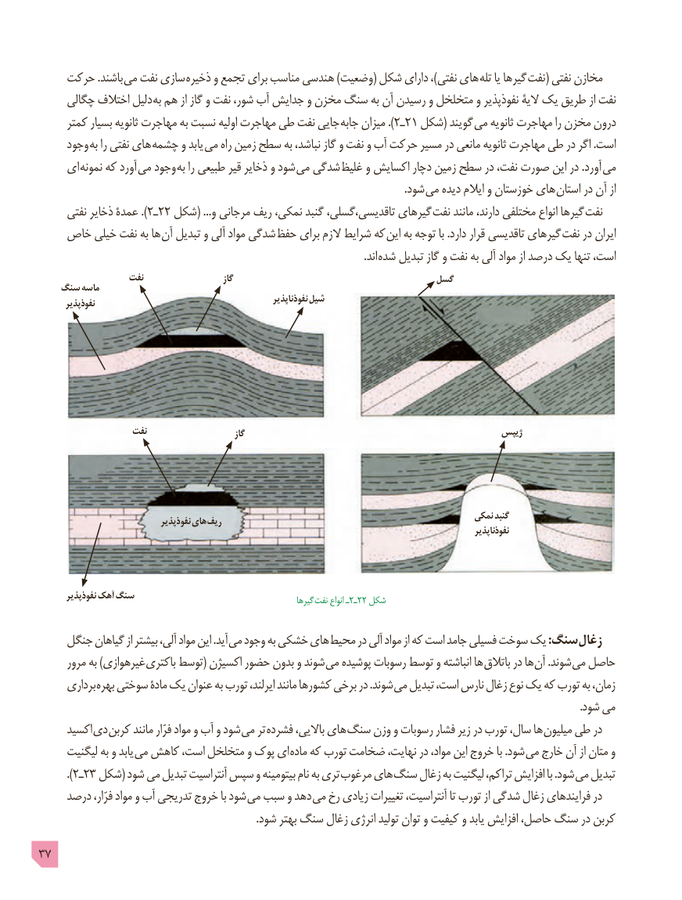

# PDF page 37

حرکت .باشند می نفت سازی ذخیره و تجمع برای مناسب هندسی )وضعیت( شکل دارای ،)نفتی های  تله یا گیرها نفت( نفتی مخازن
     چگالی اختالف دلیل به هم از گاز و نفت شور، آب جدایش و مخزن سنگ به آن رسیدن و متخلخل و نفوذپذیر الیۀ یک طریق از نفت
     کمتر بسیار ثانویه مهاجرت به نسبت اولیه مهاجرت طی نفت جایی ).جابه٢ـمیزان   21 شکل( گویند می ثانویه مهاجرت را مخزن درون
     وجود به را نفتی های چشمه و یابد  می راه زمین سطح به نباشد، گاز و نفت و آب حرکت مسیر در مانعی ثانویه مهاجرت طی در اگر .است
     ای نمونه که آورد می وجود به را طبیعی قیر ذخایر و شود می شدگی غلیظ و اکسایش دچار زمین سطح در نفت، صورت این در .آورد  می
                               . شود می دیده ایالم و خوزستان های استان در آن از
      نفتی ذخایر عمدۀ ).٢ـ22 شکل( ...و مرجانی ریف نمکی، گنبد تاقدیسی،گسلی، گیرهای نفت مانند دارند، مختلفی انواع گیرها  نفت
   خاص خیلی نفت به ها آن تبدیل و آلی مواد شدگی حفظ برای الزم شرایط که  این به توجه با .دارد قرار تاقدیسی گیرهای نفت در ایران
                                      . اند شده تبدیل گاز و نفت به آلی مواد از درصد یک تنها است،
                  نفت                      گاز                                  گسل
   سنگ ماسه
                                                                  نفوذناپذیر شیل       نفوذپذیر

                   نفت                         گاز                                                ژیپس

                                                                                          نمکی گنبد                                نفوذپذیر های ریف
                                                                                                                             نفوذناپذیر

       نفوذپذیر آهک سنگ                                              گیرها نفت٢ـ٢انواع ـ   2 شکل

    جنگل گیاهان از بیشتر آلی، مواد این .آید می وجود به خشکی های محیط در آلی مواد از که است جامد فسیلی سوخت یک :سنگ زغال
      مرور به )غیرهوازی باکتری توسط( اکسیژن حضور بدون و شوند می پوشیده رسوبات توسط و انباشته ها باتالق در ها آن .شوند می حاصل
      برداری بهره سوختی مادۀ یک عنوان به تورب ایرلند، مانند کشورها برخی در .شوند می تبدیل است، نارس زغال نوع یک که تورب به زمان،
                                                                                                                                                                                                           .شود می
     اکسید دی کربن مانند فرّار مواد و آب و شود می تر فشرده باالیی، های سنگ وزن و رسوبات فشار زیر در تورب سال، ها میلیون طی در
     لیگنیت به و یابد می کاهش است، متخلخل و پوک ای ماده که تورب ضخامت نهایت، در مواد، این خروج با .شود می خارج آن از متان و
         ).٢ـ23 شکل( شود می تبدیل آنتراسیت سپس و بیتومینه نام به تری مرغوب های سنگ زغال به لیگنیت تراکم، افزایش با .شود می تبدیل
     درصد فرّار، مواد و آب تدریجی خروج با شود می سبب و دهد می رخ زیادی تغییرات آنتراسیت، تا تورب از شدگی زغال فرایندهای در
                                                                                  .شود بهتر سنگ زغال انرژی تولید توان و کیفیت و یابد افزایش حاصل، سنگ در کربن
37

