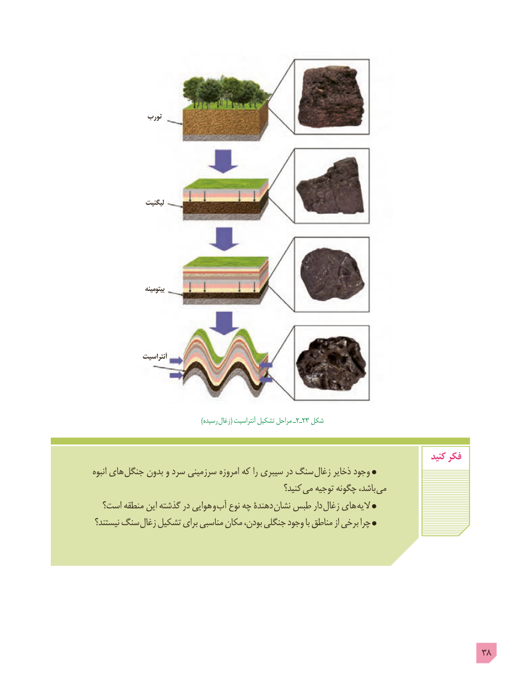

# PDF page 38

تورب

                 لیگنیت

                     بیتومینه

                آنتراسیت

            ) رسیده زغال٢ـ( آنتراسیت تشکیل مراحل ـ  23 شکل

                                                                                         کنید فکر
انبوه های جنگل بدون و سرد سرزمينی امروزه كه را سيبری در سنگ زغال ذخاير وجود
                                                     كنيد؟ می توجيه چگونه باشد،  می
  است؟ منطقه این گذشته در هوایی و آب نوع چه دهندۀ  نشان طبس دار زغال های الیه
 نیستند؟ سنگ زغال تشکیل برای مناسبی مکان بودن، جنگلی وجود با مناطق از برخی چرا

                                                                                    38

