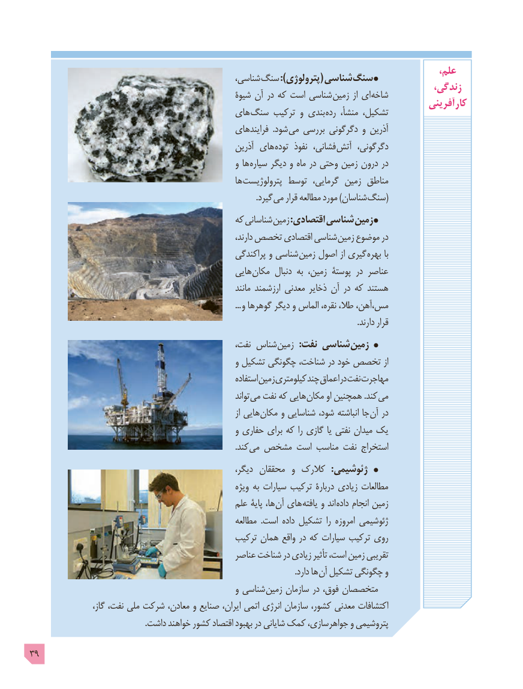

# PDF page 39

،علم                                                ،شناسی سنگ ):پترولوژی( شناسی سنگ                                                                                       زندگی،                                                   شیوۀ آن در که است شناسی زمین از ای شاخه                                                                                            آفرینی  کار                                         های سنگ ترکیب و بندی رده منشأ، تشکیل،
                                                       فرایندهای  .شود می بررسی دگرگونی و آذرین
                                                       آذرین های توده  نفوذ فشانی، آتش دگرگونی،
                                                      و ها سیاره دیگر و ماه در وحتی زمین درون در
                                                         ها پترولوژیست توسط  گرمایی، زمین مناطق
                       . گیرد می قرار مطالعه مورد )شناسان (سنگ
                                              که شناسانی زمین :اقتصادی شناسی زمین
            ،شناسیدارند تخصص اقتصادی          زمین موضوع در
                                                     پراکندگی و شناسی زمین اصول از گیری بهره با
                                                 هایی مکان دنبال به زمین، پوستۀ در عناصر
                                                                  مانند ارزشمند معدنی ذخایر آن در که هستند
                                                                                                       ... و گوهرها دیگر و الماس نقره، طال، مس،آهن،
                                                                                                                                                                .دارند قرار
                                                    نفت، شناس زمین  :نفت شناسی زمین
                                                      و تشکیل چگونگی شناخت، در خود تخصص از
                                                               استفاده زمین کیلومتری چند اعماق در نفت مهاجرت
                                                                      تواند می نفت که هایی مکان او همچنین .کند می
                                                                                   از هایی مکان و شناسایی شود، انباشته جا آن در
                                                      و حفاری برای که را گازی یا نفتی میدان یک
                         . کند می مشخص است مناسب نفت استخراج
                                                         دیگر، محققان  و کالرک  :ژئوشیمی
                                                           ویژه به سیارات ترکیب دربارۀ زیادی مطالعات
                                                 علم پایۀ ها، آن های یافته و اند داده انجام زمین
                                                         مطالعه  .است داده تشکیل  را امروزه ژئوشیمی
                                               ترکیب همان واقع در که سیارات ترکیب روی
                                                 عناصر شناخت در زیادی تأثیر است، زمین تقریبی
                    . دارد ها آن تشکیل چگونگی و
                                                      و شناسی زمین سازمان در فوق، متخصصان
                     گاز، نفت، ملی شرکت معادن، و صنایع ایران، اتمی انرژی سازمان کشور، معدنی اکتشافات
                                                        .داشت خواهند کشور اقتصاد بهبود در شایانی کمک جواهرسازی، و پتروشیمی

39

