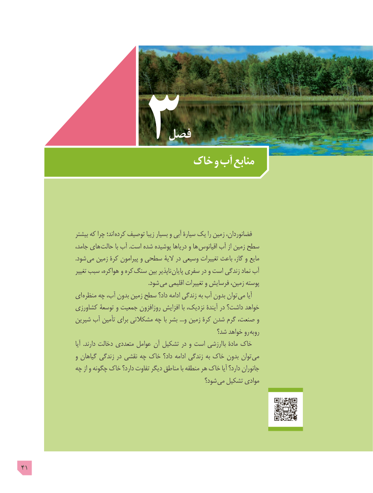

# PDF page 41

فصل
                          خاک و آب منابع

                     بیشتر که چرا اند؛  کرده توصیف زیبا بسیار و آبی سیارۀ یک را زمین فضانوردان،
                     جامد، های حالت با آب .است شده پوشیده دریاها و ها اقیانوس آب از زمین سطح
                                     .شود می زمین کرۀ پیرامون و سطحی الیۀ در وسیعی تغییرات باعث گاز، و مایع
                        تغییر سبب هواکره، و کره سنگ بین ناپذیر  پایان سفری در و است زندگی نماد آب
                    . شود می اقلیمی تغییرات و فرسایش زمین، پوسته
                ای منظره چه آب، بدون زمین سطح داد؟ ادامه زندگی به آب بدون توان می آیا
                 کشاورزی توسعۀ و جمعیت روزافزون افزایش با نزدیک، آیندۀ در داشت؟ خواهد
                 شیرین آب تأمین برای مشکالتی چه با بشر ...و زمین کرۀ شدن گرم صنعت، و
                                                            شد؟ خواهد رو روبه
                               آیا  .دارند دخالت متعددی عوامل آن تشکیل در و است ارزشی  با مادۀ خاک
                    و گیاهان زندگی در نقشی چه خاک داد؟ ادامه زندگی به خاک بدون توان می
                چه از و چگونه خاک دارد؟ تفاوت دیگر مناطق با منطقه هر خاک آیا دارد؟ جانوران
                                                            شود؟ می تشکیل موادی

41

