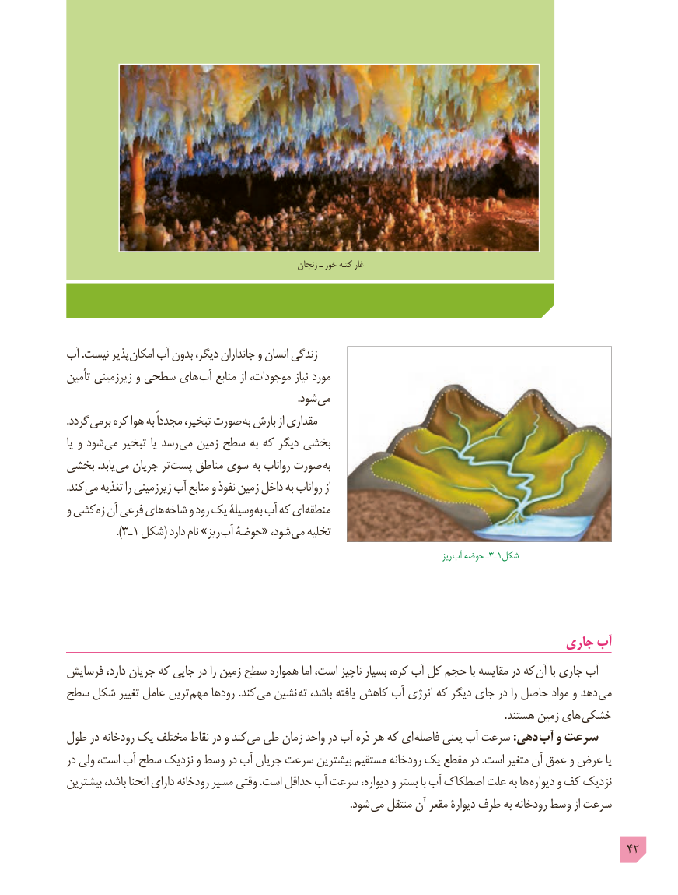

# PDF page 42

زنجان ـ خور کتله غار

آب .نیست پذیر امکان آب بدون دیگر، جانداران و انسان زندگی
تأمین زیرزمینی و سطحی های آب منابع از موجودات، نیاز مورد
                    . شود می
.گردد برمی کره هوا به مجدداً تبخیر، صورت به بارش از مقداری
یا و شود می تبخیر یا رسد می زمین سطح به که دیگر بخشی
بخشی .یابد می جریان تر پست مناطق سوی به رواناب صورت به
.کند می تغذیه را زیرزمینی آب منابع و نفوذ زمین داخل به رواناب از
و کشی زه آن فرعی های شاخه و رود یک وسیلۀ به آب که ای منطقه
                 ).ـ٣ ١ شکل( دارد نام »ریز آب حوضۀ« شود، می تخلیه
                                                                                                                    ریز  آب حوضه ـ 3ـ1شکل

                                                                       جاری آب
فرسایش دارد، جریان که جایی در را زمین سطح همواره اما است، ناچیز بسیار کره، آب کل حجم با مقایسه در که آن با جاری آب
سطح شکل تغییر عامل ترین مهم رودها .کند می نشین ته باشد، یافته کاهش آب انرژی که دیگر جای در را حاصل مواد و دهد می
           . هستند زمین های خشکی
طول در رودخانه یک مختلف نقاط در و کند می طی زمان واحد در آب ذره هر که ای  فاصله یعنی آب سرعت :دهی آب و سرعت
در ولی است، آب سطح نزدیک و وسط در آب جریان سرعت بیشترین مستقیم رودخانه یک مقطع در .است متغیر آن عمق و عرض یا
بیشترین باشد، انحنا دارای رودخانه مسیر وقتی .است حداقل آب سرعت دیواره، و بستر با آب اصطکاک علت به ها دیواره و کف نزدیک
                        . شود می منتقل آن مقعر دیوارۀ طرف به رودخانه وسط از سرعت

                                                                                            42

