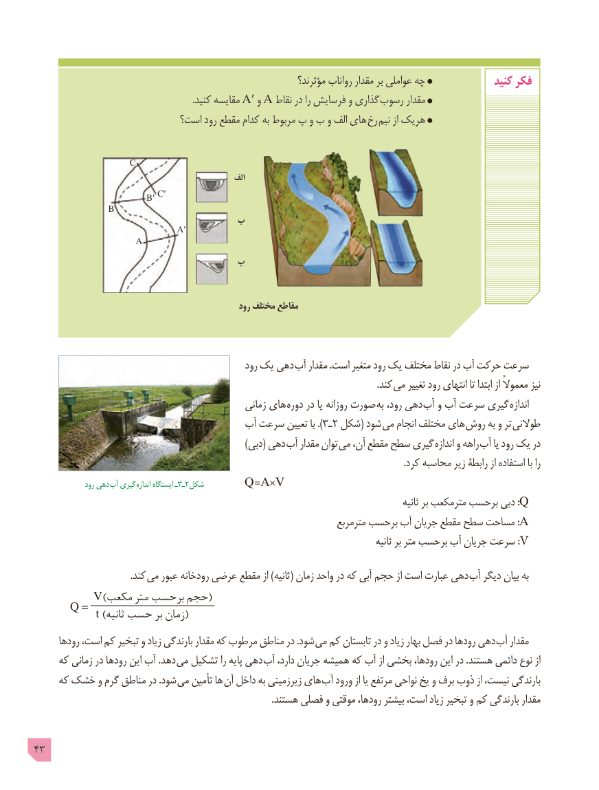

# PDF page 43

مؤثرند؟ رواناب مقدار بر عواملی چه              کنید فکر
                                                                    .کنید مقایسه A′ و A نقاط در را فرسایش و گذاری رسوب مقدار
                           است؟ رود مقطع کدام به مربوط پ و ب و الف های رخ نیم از هریک

               C
                                                        الف
                              C′C′                           B′B′
            B
                            ب
                                 A′
               A
                            پ

                                                     رود مختلف مقاطع

                                                  رود یک دهی آب مقدار .است متغیر رود یک مختلف نقاط در آب حرکت سرعت
                                    . کند می تغییر رود انتهای تا ابتدا از معموالً نیز
                                                  زمانی های  دوره در یا روزانه صورت به رود، دهی  آب و آب سرعت گیری اندازه
                                    آب سرعت تعیین با ).ـ٣ ٢ شکل( شود  می انجام مختلف های روش به و تر طوالنی
                                                                    )دبی( دهی آب مقدار توان می آن، مقطع سطح گیری اندازه و راهه آب یا رود یک در
                                                                                                                                                              .کرد محاسبه زیر رابطۀ از استفاده با را
                رود دهی آب گیری اندازه ایستگاه ـ3ـ2شکل      Q =A×V
                                                                                                                 ثانیه بر مترمکعب برحسب دبی :Q
                                                                        مترمربع برحسب آب جریان مقطع سطح مساحت : A
                                                                                                         ثانیه بر متر برحسب آب جریان سرعت : V
                                         .کند می عبور رودخانه عرضی مقطع از )ثانیه( زمان واحد در که آبی حجم از است عبارت دهی  آب دیگر بیان به
         ____________________V()مکعب متر برحسب حجم    Q =
                  t ()ثانیه حسب بر زمان
      رودها است، کم تبخیر و زیاد بارندگی مقدار که مرطوب مناطق در .شود می کم تابستان در و زیاد بهار فصل در رودها دهی آب مقدار
     که زمانی در رودها این آب .دهد می تشکیل را پایه دهی آب دارد، جریان همیشه که آب از بخشی رودها، این در .هستند دائمی نوع از
     که خشک و گرم مناطق در .شود  می تأمین ها آن داخل به زیرزمینی های آب ورود از یا مرتفع نواحی یخ و برف ذوب از نیست، بارندگی
                                                                                                     .هستند فصلی و موقتی رودها، بیشتر است، زیاد تبخیر و کم بارندگی مقدار

43

