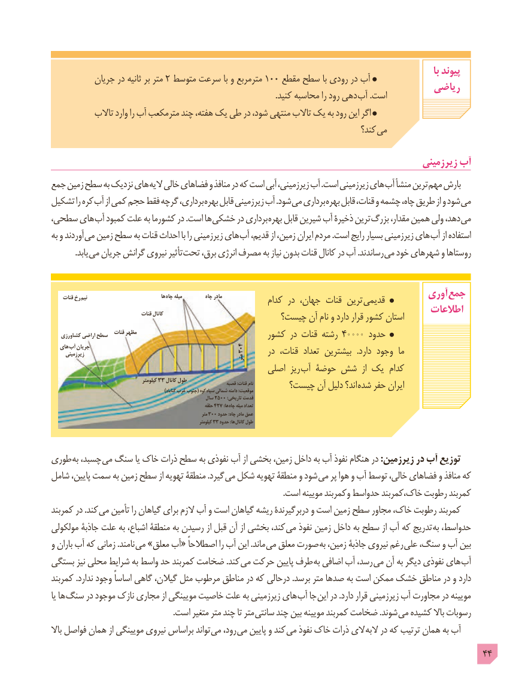

# PDF page 44

با پیوند   جریان٢در ثانیه بر متر متوسط١٠٠سرعت با و مترمربع    مقطع سطح با رودی در آب                                                                        ریاضی                                                                                                              .کنید محاسبه را رود دهی آب .است
           تاالب وارد را آب مترمکعب چند هفته، یک طی در شود، منتهی تاالب یک به رود این اگر
                                                                                 کند؟  می

                                                                                     زیرزمینی آب
جمع زمین سطح به نزدیک های الیه خالی فضاهای و منافذ در که است آبی زیرزمینی، آب .است زیرزمینی های آب منشأ ترین مهم بارش
تشکیل را کره آب از کمی حجم فقط گرچه برداری، بهره قابل زیرزمینی آب .شود می برداری بهره قابل قنات، و چشمه چاه، طریق از و شود می
سطحی، های آب کمبود علت به کشورما در .است ها خشکی در برداری بهره قابل شیرین آب ذخیرۀ ترین بزرگ مقدار، همین ولی دهد، می
به و آوردند می زمین سطح به قنات احداث با را زیرزمینی های آب قدیم، از زمین، ایران مردم .است رایج بسیار زیرزمینی های آب از استفاده
   . یابد می جریان گرانش نیروی تأثیر تحت برق، انرژی مصرف به نیاز بدون قنات کانال در آب .رساندند می خود شهرهای و روستاها

     قنات رخ  نیم                                 ها چاه میله          چاه مادر                                          آوری جمع                                                         کدام در جهان، قنات ترین قدیمی
                                   قنات کانال                                                         اطالعات                                            چیست؟ آن نام و دارد قرار کشور استان
                        قنات مظهر   کشاورزی اراضی سطح                                   کشور در قنات رشته 40000 حدود
   های  آب جریان                                           304      زیرزمینی                                             متر      در قنات،  تعداد بیشترین   .دارد وجود  ما
                                                اصلی ریز  آب حوضۀ شش  از یک  کدام
                                           کیلومتر 33                                                     کانال                                         طول                                                                          قصبه                                                                                                                                                           :قنات                                                                                                          نام                                              چیست؟ آن دلیل اند؟ شده حفر ایران                                                                      گناباد غرب                                                                                                   دامنه                                                                                                                                                            :موقعیت     )                                                    جنوب( کوه سیاه شمالی
                                                          سال 2500 :تاریخی قدمت
                                                                         حلقه 427 :ها  چاه میله تعداد
                                                                               متر 300 حدود :چاه مادر عمق
                                                                                  کیلومتر 33 حدود :ها کانال طول

طوری به چسبد، می سنگ یا خاک ذرات سطح به نفوذی آب از بخشی زمین، داخل به آب نفوذ هنگام در :زیرزمین در آب توزیع
شامل پایین، سمت به زمین سطح از تهویه منطقۀ .گیرد می شکل تهویه منطقۀ و شود می پر هوا و آب توسط خالی، فضاهای و منافذ که
                                                                                                                  .است مویینه وکمربند حدواسط خاک،کمربند رطوبت کمربند
کمربند در .کند می تأمین را گیاهان برای الزم آب و است گیاهان ریشه دربرگیرندۀ و است زمین سطح مجاور خاک، رطوبت کمربند
مولکولی جاذبۀ علت به اشباع، منطقۀ به رسیدن از قبل آن از بخشی کند، می نفوذ زمین داخل به سطح از آب که تدریج به حدواسط،
و باران آب که زمانی .نامند می »معلق آب« اصطالحاً را آب این .ماند می معلق صورت به زمین، جاذبۀ نیروی رغم علی سنگ، و آب بین
بستگی نیز محلی شرایط به واسط حد کمربند ضخامت .کند می حرکت پایین طرف به اضافی آب رسد، می آن به دیگر نفوذی های آب
کمربند .ندارد وجود اساساً گاهی گیالن، مثل مرطوب مناطق در که درحالی .برسد متر صدها به است ممکن خشک مناطق در و دارد
یا ها سنگ در موجود نازک مجاری از مویینگی خاصیت علت به زیرزمینی های آب جا این در .دارد قرار زیرزمینی آب مجاورت در مویینه
                                                            .است متغیر متر چند تا متر سانتی چند بین مویینه کمربند ضخامت .شوند می کشیده باال رسوبات
باال فواصل همان از مویینگی نیروی براساس تواند می رود، می پایین و کند می نفوذ خاک ذرات الی البه در که ترتیب همان به آب
                                                                                            44

