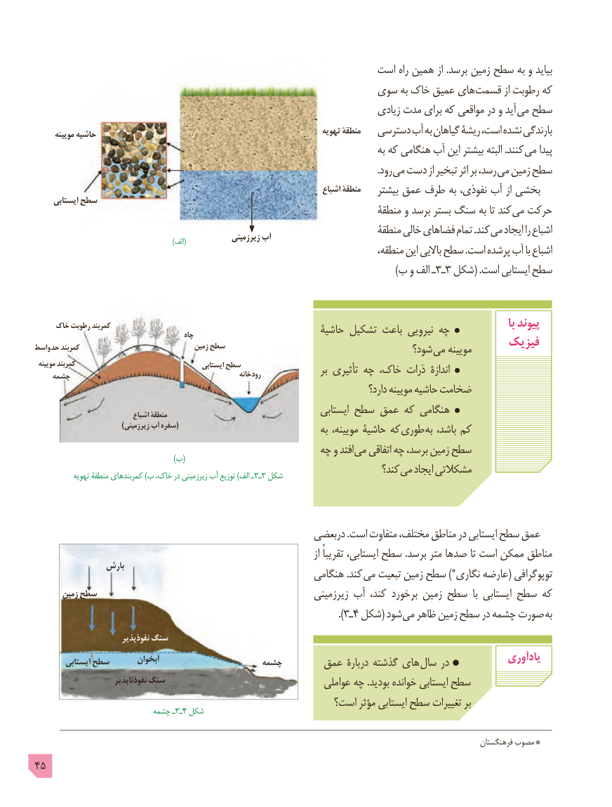

# PDF page 45

است راه همین از .برسد زمین سطح به و بیاید
                                                   سوی به خاک عمیق های قسمت از رطوبت که
                                                                           زیادی مدت برای که مواقعی در و آید می سطح
      مویینه حاشیه                                                             تهویه منطقۀ   دسترسی آب به گیاهان ریشۀ است، نشده بارندگی
                                                                                         به که هنگامی آب این بیشتر البته .کنند می پیدا
                                      . رود می دست از تبخیر اثر بر رسد، می زمین سطح
                                                                               اشباع منطقۀ    بیشتر عمق طرف به نفوذی، آب از بخشی
     ایستابی سطح
                                                                        منطقۀ و برسد بستر سنگ به تا کند می حرکت
                                                                        منطقۀ خالی فضاهای تمام .کند می ایجاد را اشباع                     )(الف             زیرزمینی آب
                                                                              منطقه، این باالیی سطح .است پرشده آب با اشباع
                                                                                                                  )ب و الف ـ3ـ 3 شکل( .است ایستابی سطح

     خاک رطوبت کمربند                                                                                                                     با پیوند                                              چاه                           حاشیۀ تشکیل باعث نیرویی چه
واسط حد کمربند                                زمین سطح                                              فیزیک                                                                            شود؟ می مویینه
 مویینه       کمربند                                        ایستابی سطح                                                                  رودخانه                بر تأثیری چه خاک، ذرات  اندازۀ    چشمه
                                                                                          دارد؟ مویینه حاشیه ضخامت
                              اشباع منطقۀ                                     ایستابی سطح عمق که هنگامی
                                    )زیرزمینی آب سفره(                                     به مویینه، حاشیۀ که طوری به باشد، کم
                                                   چه و افتد می اتفاقی چه برسد، زمین سطح                        )(ب
                                                                              کند؟ می ایجاد مشکالتی            تهویه منطقۀ کمربندهای )ب خاک، در زیرزمینی آب توزیع )الف ـ 3ـ3 شکل

                                                     دربعضی .است متفاوت مختلف، مناطق در ایستابی سطح عمق
                                                                                              از تقریباً ایستابی، سطح .برسد متر صدها تا است ممکن مناطق
                بارش                                      هنگامی .کند  می تبعیت زمین سطح *) نگاری عارضه( توپوگرافی
       زمین سطح                                                  زیرزمینی آب کند، برخورد زمین سطح  با ایستابی سطح که
                                                                                                                 ).ـ٣ ٤ شکل( شود می ظاهر زمین سطح در چشمه صورت  به
                          نفوذپذیر سنگ
         ایستابی سطح       آبخوان                    چشمه      عمق دربارۀ گذشته های سال در            یادآوری
                         نفوذناپذیر سنگ                                                                عواملی چه .بودید خوانده ایستابی سطح
                                                      است؟ مؤثر ایستابی سطح تغییرات بر                 چشمه٤ـ٣ـ شکل

                                                                                                                          فرهنگستان مصوب *
45

