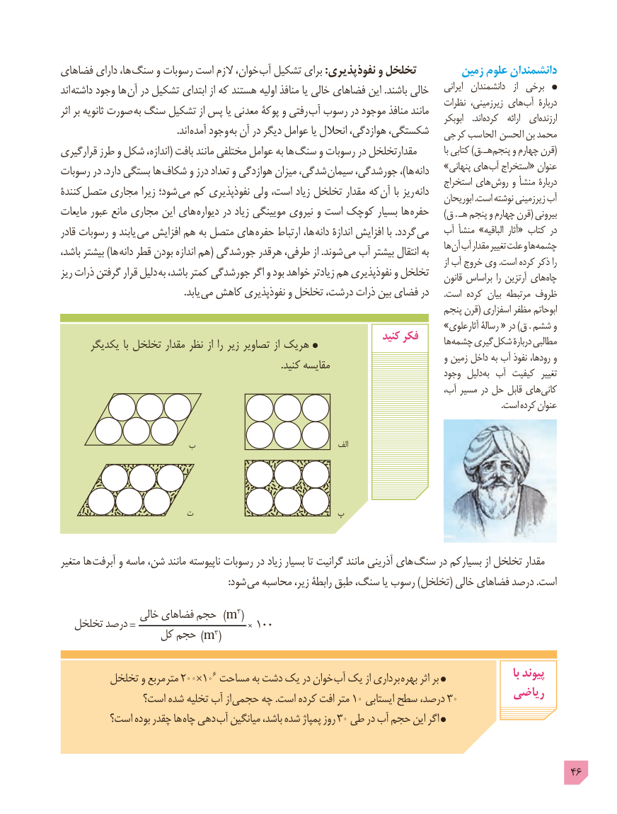

# PDF page 46

فضاهای دارای ها، سنگ و رسوبات است الزم خوان، آب تشکیل برای :نفوذپذیری و تخلخل        زمین علوم دانشمندان
اند داشته وجود ها آن در تشکیل ابتدای از که هستند اولیه منافذ یا خالی فضاهای این .باشند خالی     ایرانی  دانشمندان   از  برخی
                                                                                       نظرات زیرزمینی، های آب  دربارۀاثر بر ثانویه صورت به سنگ تشکیل از پس یا معدنی پوکۀ و رفتی آب رسوب در موجود منافذ مانند                                                                                                                     ابوبکر    .اند کرده   ارائه  ای ارزنده
                                                .اند آمده وجود به آن در دیگر عوامل یا انحالل هوازدگی، شکستگی،   کرجی  الحاسب  الحسن  بن  محمد
قرارگیری طرز و شکل اندازه،( بافت مانند مختلفی عوامل به ها سنگ و رسوبات در مقدارتخلخل           با کتابی )ق. هـ (پنجم و چهارم قرن
                                                                        »پنهانی های آب استخراج« عنوانرسوبات در .دارد بستگی ها شکاف و درز تعداد و هوازدگی میزان شدگی، سیمان جورشدگی، ،)ها دانه                                                                                              استخراج های روش و منشأ دربارۀکنندۀ  متصل مجاری زیرا شود؛ می کم نفوذپذیری ولی است، زیاد تخلخل مقدار که آن با ریز دانه                                                                                                        ابوریحان .است نوشته زیرزمینی آب
مایعات عبور مانع مجاری این های دیواره در زیاد مویینگی نیروی و است کوچک بسیار ها حفره     )ق . هـ پنجم و چهارم قرن( بیرونی
قادر رسوبات و یابند می افزایش هم به متصل های حفره ارتباط ها، دانه اندازۀ افزایش با .گردد می   آب منشأ »الباقیه  آثار« کتاب در
                                                                                                     ها آن آب مقدار تغییر علت و ها چشمهباشد، بیشتر )ها دانه قطر بودن اندازه هم( جورشدگی هرقدر طرفی، از .شوند می آب بیشتر انتقال به                                                                                                                                                       از آب خروج وی .است کرده ذکر راریز ذرات گرفتن قرار دلیل به باشد، کمتر جورشدگی اگر و بود خواهد زیادتر هم نفوذپذیری و تخلخل                                                                                                        قانون براساس را آرتزین های چاه
                                                   .یابد  می کاهش نفوذپذیری و تخلخل درشت، ذرات بین فضای در       .است کرده بیان مرتبطه ظروف
                                                                                     پنجم قرن( اسفزاری مظفر ابوحاتم
                                                                        »علوی آثار رسالۀ « در )ق . ششم و
                                                                        کنید فکر      یکدیگر  با تخلخل مقدار نظر از را زیر تصاویر از هریک                                    ها چشمه گیری شکل دربارۀ مطالبی
                                                                                                 و زمین داخل به آب نفوذ رودها، و                                                                                            .کنید مقایسه                                                                                          وجود  دلیل به آب کیفیت  تغییر
                                                                                            آب، مسیر در حل قابل های کانی
                                                                                                                                                                                                              .است کرده عنوان

                   ب                                         الف

                   ت                     پ

متغیر ها آبرفت و ماسه شن، مانند ناپیوسته رسوبات در زیاد بسیار تا گرانیت مانند آذرینی های سنگ در بسیارکم از تخلخل مقدار
                : شود می محاسبه زیر، رابطۀ طبق سنگ، یا رسوب )تخلخل( خالی فضاهای درصد .است
                 خالی فضاهای حجم )m3(  تخلخل درصد =100+               کل حجم )m3(

         تخلخل و مربع متر 200×106 مساحت به دشت یک در خوان آب یک از برداری بهره اثر بر                      با پیوند
                                                                        ریاضی               است؟ شده تخلیه آب از حجمی چه .است کرده افت متر 10 ایستابی سطح درصد، 30
         است؟ بوده چقدر ها چاه دهی 3آب میانگین باشد، شده پمپاژ روز 0 طی در آب حجم این اگر

                                                                                            46

